# MarkNote

macOS용 가벼운 마크다운 뷰어 + 편집기. 폴더 하나를 지정하면 그 안의 `.md` 파일 목록을 사이드바에 보여주고, 왼쪽엔 원문, 오른쪽엔 렌더링 결과를 동시에 띄웁니다. 머메이드 다이어그램, 코드 구문 색상, LaTeX 수식까지 앱 안에 동봉된 라이브러리로 오프라인 렌더링합니다.

A tiny native Markdown viewer and editor for macOS. Point it at a folder, pick a `.md` file, read the rendered preview on the right and edit the raw source on the left. Autosaves locally, exports standalone HTML, and renders Mermaid diagrams, highlighted code and KaTeX math from libraries bundled in the app — no network access at any point.

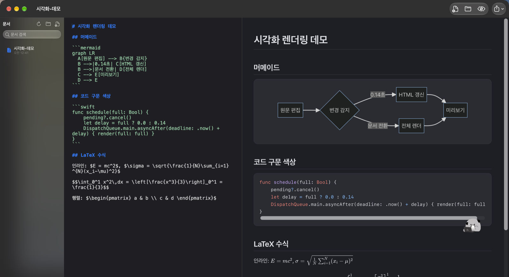

- **네이티브 앱** — AppKit으로만 작성된 단일 창. 웹 래퍼가 아니고, Electron·RN·SwiftUI 의존성이 없습니다.
- **로컬 전용** — 서버·분석·업데이트 체크가 없습니다. 문서가 기기를 벗어나지 않습니다. 미리보기와 내보내기는 전부 오프라인이며 CDN을 호출하지 않습니다.
- **Xcode 불필요** — Command Line Tools만으로 빌드되는 `.app` 번들 스크립트를 함께 담고 있습니다.

## 요구 사항

- macOS 13 Ventura 이상 (Apple silicon / Intel 모두)
- Command Line Tools (`xcode-select --install`)
- 외부 의존성 없음 — 순수 Swift + 기본 프레임워크(AppKit, WebKit). 렌더러 라이브러리는 `Resources/vendor/`에 사본으로 들어 있습니다.

## 빌드 & 실행

```bash
git clone https://github.com/proxsolver/MarkNote.git
cd MarkNote
./build.sh --install --open
```

`.build/MarkNote.app`에 번들이 생기고, `--install`은 `~/Applications/MarkNote.app`으로 복사해 바로 실행합니다. 애드혹 서명만 적용되므로 처음 실행 시 macOS가 막으면 `시스템 설정 > 개인정보 보호 및 보안 > 여전히 열기`를 누르세요.

| 명령 | 동작 |
| --- | --- |
| `./build.sh` | `.build/MarkNote.app` 빌드 |
| `./build.sh --install` | `~/Applications`에 설치 |
| `./build.sh --install --open` | 설치 후 실행 |

## 기능

- **사이드바 목록** — 지정 폴더(하위 폴더 포함)의 `.md` / `.markdown` / `.mdown` 파일을 나열. 검색, 이름 변경, 휴지통으로 삭제, 드래그＆드롭으로 파일·폴더 추가.
- **정렬** — 이름 / 최근 수정 / 생성일 기준에 오름·내림차순을 조합합니다. 사이드바 위쪽의 정렬 바 또는 `보기 ▸ 사이드바 정렬` 메뉴로 바꾸고, 선택이 설정에 저장되어 다음 실행에도 그대로입니다. 지금 열어 둔 노트는 정렬과 무관하게 항상 맨 위에 고정됩니다.
- **RTF로 저장된 노트도 읽힘** — 확장자만 `.md`이고 내용은 RTF인 파일(TextEdit이나 일부 채팅·에이전트 도구가 그렇게 저장합니다)을 감지해 텍스트로 변환해 보여줍니다. 여는 것만으로 원본 파일은 바뀌지 않고, 실제로 저장할 때 비로소 마크다운 텍스트로 정리됩니다.
- **라이브 미리보기** — 타이핑에 반응해 렌더링 결과가 즉시 갱신됩니다. 편집기와 미리보기 스크롤이 양방향 동기화되며, 미리보기는 언제든 접을 수 있습니다.
- **자동 저장** — 입력을 멈추면 0.7초 뒤 원본 파일에 바로 씁니다. 창을 닫거나 앱을 종료할 때 대기 중인 저장도 처리합니다. 다른 프로그램이 파일을 바꾼 경우 감지해 알려줍니다.
- **마크다운 지원** — 제목, 강조/기울임, 취소선, 인라인 코드, 코드 블록(언어 라벨 포함), 인용, 순서·비순서 목록, 중첩 목록, 작업 목록(`- [ ]` / `- [x]`), 표, 구분선, 링크와 이미지. 한글 본문에서도 강조 마커가 정상 동작합니다.
- **다이어그램·구문 색상·수식** — ` ```mermaid ` 펜스는 다이어그램으로, 언어가 지정된 코드 블록은 하이라이트.js로, `$…$` / `$$…$$` / `\(…\)` / `\[…\]` 안의 LaTeX는 KaTeX로 렌더링됩니다. 라이브러리 사본이 앱 안에 들어 있어 인터넷 없이 동작하고, `보기 ▸ 그림·수식 렌더링`으로 언제든 끌 수 있습니다.
- **이미지·문서 상대 링크** — 미리보기는 열어 둔 문서의 폴더를 기준 삼아 ``를 표시하고, `[다른 노트](other.md)` 링크를 누르면 그 노트를 편집기로 엽니다.
- **위키 링크** — `[[다른 노트]]`처럼 대괄호 두 개로 노트를 가리키면 미리보기와 내보낸 HTML에서 실제 링크가 되고, 클릭하면 그 노트로 갑니다. 별칭(`[[노트|라벨]]`)과 구절 참조(`[[노트#원칙]]`, `[[#이 문단의 제목]]`)도 됩니다. 아직 없는 노트를 가리키는 링크는 회색 점선으로 표시되고, 그 이름으로 노트를 만들기만 하면 그대로 연결됩니다.
- **이 문서를 참조(백링크)** — 사이드바 아래 접이 패널에 *이 노트를 가리키는 다른 노트* 목록이 뜨고, 행을 누르면 참조한 노트의 그 줄로 이동합니다. 위키 링크(가장 강한 근거), 마크다운 링크, 단순 제목 언급(가장 약한 표시)을 구분해 보여주고, 근거가 된 줄의 앞부분을 함께 표시합니다.
- **HTML 내보내기** — CSS를 동봉한 단일 `.html` 파일로 저장(라이트/다크 팔레트), 기본 브라우저에서 열기, HTML 클립보드 복사. `시각화 포함 HTML 내보내기`는 다이어그램·색상·수식 라이브러리(약 3.8 MB)와 폰트까지 파일 안에 직접 박아 넣어서, HTML 하나만 옮겨도 그대로 렌더링됩니다.
- **단축키·편집 보조** — 서식 단축키, Enter 시 목록 자동 이어짐, 들여쓰기 Tab / 내어쓰기 ⇧Tab, 커서가 문자 안에 있으면 그 단어를 감싸는 토글 동작.
- **상태 유지** — 폴더, 마지막으로 열던 문서, 최근 문서, 정렬 기준·방향, 참조 패널 펼침 여부, 미리보기 표시 여부, 글자 크기, 자동 저장·스크롤 동기화·시각화 렌더링 설정이 모두 복구됩니다.

## 단축키

| 작업 | 키 |
| --- | --- |
| 새 문서 / 열기 / 저장 | `⌘N` `⌘O` `⌘S` |
| 디스크 내용으로 되돌리기 | `⇧⌘V` |
| 굵게 / 기울임 / 취소선 | `⌘B` `⌘I` `⇧⌘X` |
| 인라인 코드 / 코드 블록 | `⌘E` `⇧⌘K` |
| 링크 | `⌘K` |
| 위키 링크 `[[노트]]` | `⌥⌘K` |
| 제목 1·2·3 / 제목 해제 | `⌘1` `⌘2` `⌘3` `⌘0` |
| 순서 목록 / 비순서 목록 / 인용 | `⌥⌘L` `⇧⌘L` `⇧⌘Q` |
| 구분선 | `⇧⌘D` |
| 미리보기 토글 | `⌘R` |
| 사이드바 토글 | `⌃⌘S` |
| 정렬: 이름 / 최근 수정 / 생성일 | `⌥⌘1` `⌥⌘2` `⌥⌘3` |
| 정렬 방향 바꾸기 | `⇧⌥⌘S` |
| 이 문서를 참조 패널 열기·닫기 | `⌥⌘B` |
| Finder에서 보기 / 문서 폴더 열기 | `⌥⌘R` `⌥⌘O` |
| 글자 크기 늘림 / 줄임 / 초기화 | `⌘+` `⌘-` `⌥⌘0` |
| HTML 내보내기 / 시각화 포함 내보내기 | `⇧⌘E` `⌥⇧⌘E` |
| 브라우저에서 열기 / HTML 복사 | `⇧⌘B` `⌥⇧⌘C` |

## 시각화 렌더링 방식

미리보기는 `marknote://` 커스텀 스킴으로 리소스를 공급합니다. 페이지 기준 URL이 `marknote://assets/doc/`이라 문서 옆 이미지·링크는 상대 경로로 그대로 해결되고, `marknote://assets/vendor/`은 앱 번들 안의 라이브러리 폴더를 가리킵니다. 두 경로가 같은 오리진이라 웹폰트 요청까지 네트워크 없이 통과합니다.

`내보내기`는 스타일과 스크립트를 HTML 안에 직접 넣고 KaTeX 폰트를 base64 data URI로 변환하므로, 결과물이 특정 머신의 경로에 의존하지 않습니다. 라이브러리가 없거나 렌더링이 실패하면 페이지가 깨지지 않습니다 — 머메이드 원문은 그대로 보이고, 실패한 블록에는 오류 메시지가 표시되며, `시각화 포함` 내보내기는 자동으로 가벼운 HTML로 대체됩니다.

동봉 버전과 라이선스: Mermaid 10.9.3(MIT), highlight.js 11.9.0(BSD-3-Clause), KaTeX 0.16.11(MIT). 원본 라이선스 전문은 `Resources/vendor/licenses/`, 파일별 sha256과 출처는 `Resources/vendor/manifest.json`에 있습니다.

## 예제 — 복사해서 붙여넣기

아래 블록들은 이 앱에서 실제로 렌더링되는지 확인한 원문입니다. 코드 블록 우측 상단의 복사 버튼을 누르면 감싸는 백틱 없이 안쪽만 복사됩니다. 모든 예제가 한 파일에 담긴 [`docs/예제-모음.md`](docs/예제-모음.md)를 MarkNote로 열면 원문과 결과를 나란히 볼 수 있습니다.

### 서식

````markdown
**굵게**, *기울임*, ~~취소선~~, `인라인 코드`, {{형광펜}}, [링크](https://example.com), <https://example.com>
````

### 목록과 표

````markdown
- 글머리
  - 들여쓰면 하위 목록
    - 세 단계도 됩니다
- [ ] 할 일
- [x] 끝난 일

1. 번호 목록
2. 아래로 들여쓰면 종류를 바꿔도 됩니다
   - 안쪽 글머리
   1. 안쪽 번호

| 기능 | 단축키 | 상태 |
| --- | :--: | --- |
| 미리보기 토글 | `⌘R` | 됨 |
| 시각화 포함 내보내기 | `⌥⇧⌘E` | 됨 |
````

### 코드 블록

펜스 뒤에 붙이는 라벨이 하이라이트 언어를 결정합니다. 라벨이 없으면 색상 없이 그대로 표시됩니다.

````markdown
```swift
func save(_ doc: Note) throws {
    // 한글 주석도 그대로
    try doc.write(to: url, atomically: true)
}
```

```python
def fib(n):
    a, b = 0, 1
    for _ in range(n):
        a, b = b, a + b
    return a
```

```sql
SELECT title, updated_at
FROM docs
WHERE folder = 'MarkNote'
ORDER BY updated_at DESC;
```

```bash
./build.sh --install --open   # 빌드 후 ~/Applications에 설치
```

```json
{ "name": "MarkNote", "offline": true }
```
````

쓸 수 있는 언어 라벨(36개): `bash` `c` `cpp` `csharp` `css` `diff` `go` `graphql` `ini` `java` `javascript` `json` `kotlin` `less` `lua` `makefile` `markdown` `objectivec` `perl` `php` `php-template` `plaintext` `python` `python-repl` `r` `ruby` `rust` `scss` `shell` `sql` `swift` `typescript` `vbnet` `wasm` `xml` `yaml`

줄임말도 인식합니다: `js` `jsx` `ts` `tsx` `py` `pycon` `rb` `yml` `md` `sh` `console` `c++` `cs` `html` `svg` `toml` `text` `rs` `kt` `objc` `vb` `golang` `make` `patch` `gql`

### LaTeX 수식

````markdown
인라인: $E = mc^2$, $\frac{a}{b}$, $\sqrt{x}$, $\alpha\beta\gamma$, $\sum_{i=1}^{n} i$

$$\int_0^1 x^2\,dx = \frac{1}{3}$$

$$\lim_{n\to\infty}\left(1+\frac{1}{n}\right)^n = e$$

$$\mathbf{A} = \begin{pmatrix} a & b \\ c & d \end{pmatrix}, \quad \begin{bmatrix} 1 \\ 2 \end{bmatrix}$$

$$f(x) = \begin{cases} 1 & x \gt 0 \\ -1 & x \lt 0 \end{cases}$$

$$\overline{x} \ne \underline{x}, \quad \left\lceil \frac{n}{2} \right\rceil, \quad \boxed{42}$$
````

`$$ … $$` 대신 `\( … \)`(인라인)과 `\[ … \]`(블록)도 인식합니다. 달러표를 글자로 쓰려면 `\$`로 이스케이프하세요 — `가격은 $5와 $10` 같은 문장은 수식으로 잡힙니다.

### 다이어그램

`flowchart`, `graph`, `sequenceDiagram`, `classDiagram`, `stateDiagram-v2`, `erDiagram`, `gantt`, `pie`, `journey`, `mindmap`, `timeline`, `quadrantChart`, `gitGraph`, `xychart-beta`, `sankey-beta`, `block-beta` 열여섯 종류가 확인됐습니다. 라벨에 한글을 써도 됩니다.

````markdown
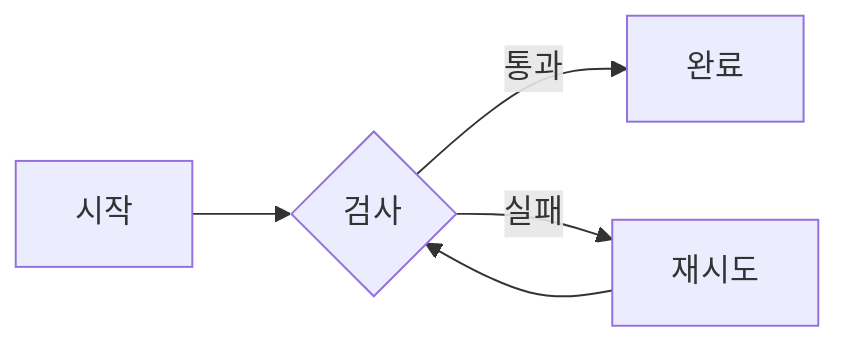
````

````markdown
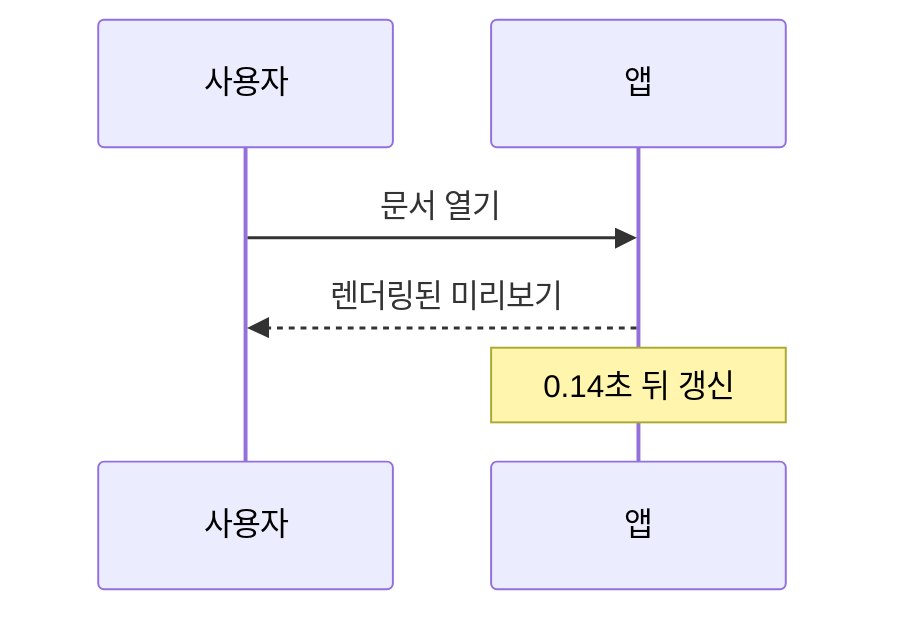
````

````markdown
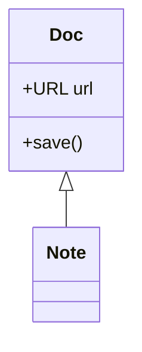
````

````markdown
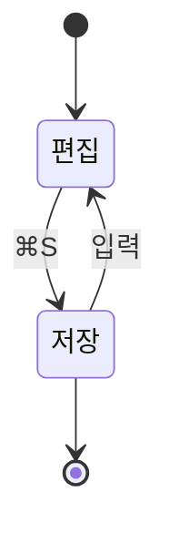
````

````markdown
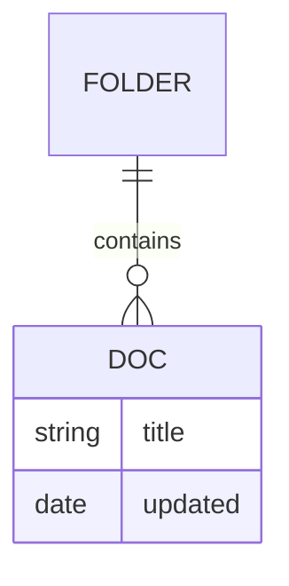
````

````markdown
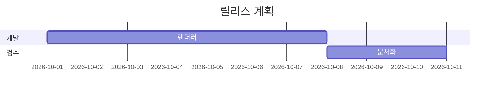
````

````markdown
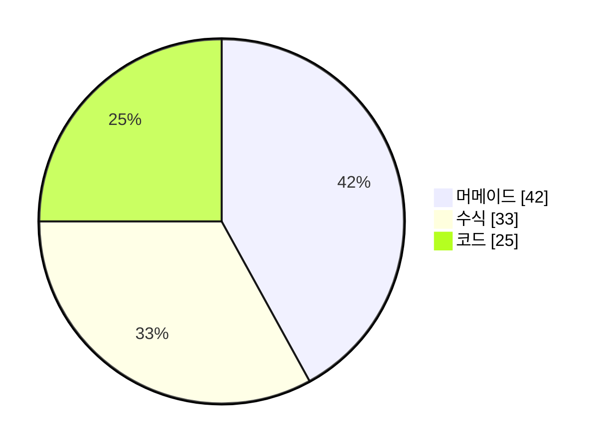
````

````markdown
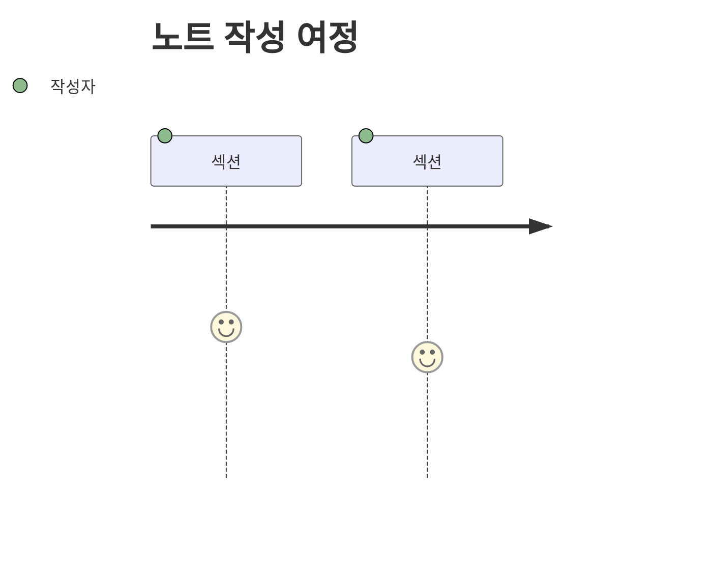
````

````markdown
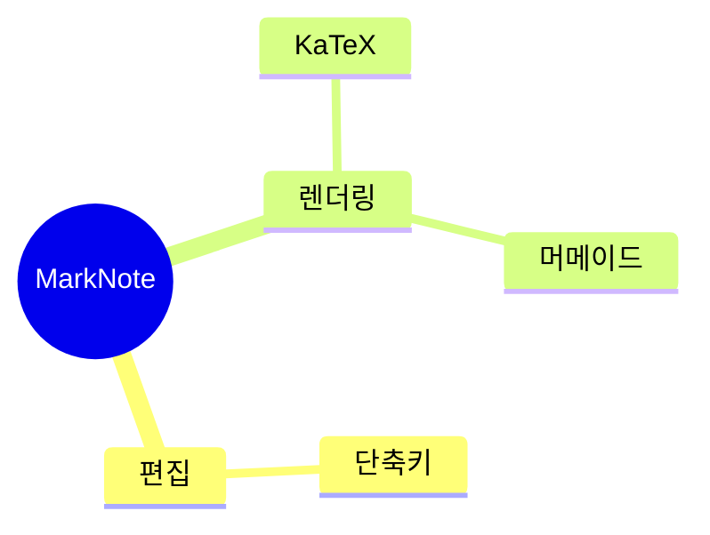
````

````markdown
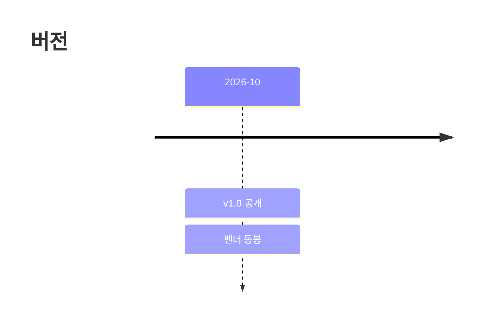
````

````markdown
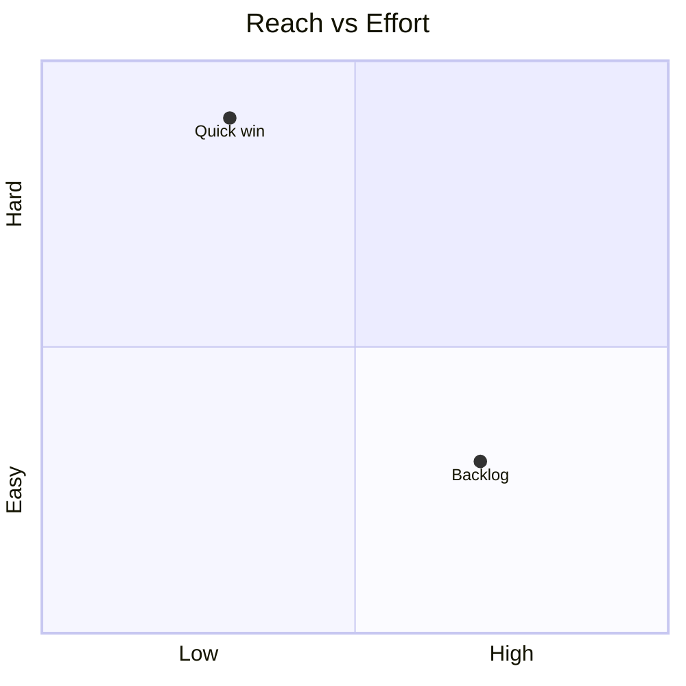
````

````markdown
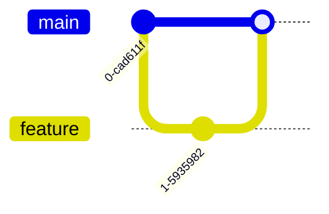
````

````markdown
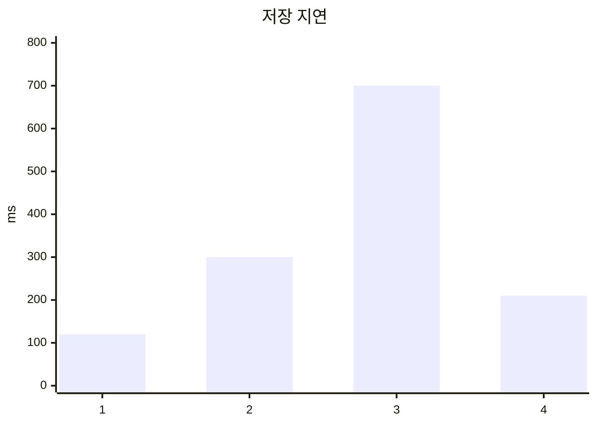
````

````markdown
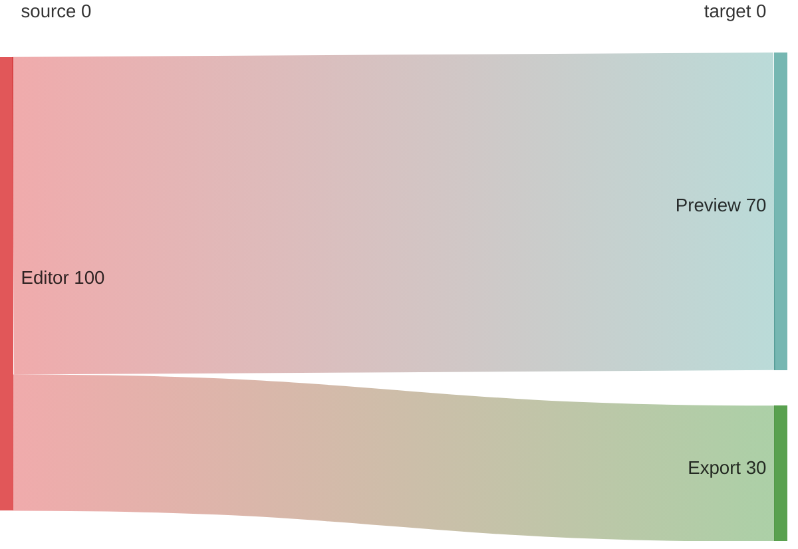
````

````markdown

````

`packet-beta`, `architecture-beta`, `ishikawa-beta`, `kanban`, `requirementDiagram`은 동봉된 10.9.3 UMD 빌드에 포함되어 있지 않습니다. 이 경우 다이어그램은 그림 대신 원문 텍스트 카드로 남으니 내용은 잃지 않습니다.

### 이미지와 노트 링크

````markdown

[다른 노트](other.md)
````

미리보기는 열어 둔 문서의 폴더를 기준으로 삼습니다. 다른 노트 링크를 클릭하면 편집기가 그 파일을 엽니다.

### 위키 링크와 백링크

````markdown
오늘 이야기는 [[회의록]] 에 정리했다.
별칭도 된다: [[회의록|2주 회의록]].
다른 노트의 제목으로: [[회의록#결정 사항]]
같은 노트 안에서: [#결정 사항]
없는 노트도 가리킬 수 있다: [[아직-없는-노트]]  ← 점선으로 표시되고, 저장하면 연결된다
````

`서식 ▸ 위키 링크 [[노트]]`(`⌥⌘K`)가 커서를 감싸고, 없는 선택이면 자리에 `[[노트 이름]]`을 넣어 줍니다.

`[[회의록]]`을 적은 쪽이 **나가는 링크**, 회의록.md를 열었을 때 사이드바 아래에 뜨는 목록이 **백링크**입니다. 아래 예제처럼 두 노트를 같은 폴더에 만들면 양쪽이 실제로 채워집니다.

````markdown
<!-- 노트: 프로젝트-원칙.md -->
# 프로젝트 원칙

- 한 번에 한 파일만 고친다 → [[안전-규칙]]
- 저장하기 전에는 항상 테스트 실행
````

````markdown
<!-- 노트: 안전-규칙.md -->
# 안전 규칙

이 규칙을 [[프로젝트-원칙]] 에서 인용한다.
````

`안전-규칙.md`를 열면 사이드바 아래에 `이 문서를 참조 (1)`이 뜨고, 행을 누르면 `프로젝트-원칙.md`의 그 줄로 갑니다. 반대로 `프로젝트-원칙.md` 안에서 위키 링크는 클릭 가능한 실선 링크, 아직 존재하지 않는 `[[아직-없는-노트]]`는 회색 점선으로 보입니다.

## 저장소 구성

```
Sources/
  App.swift            앱 생명주기, 메인 메뉴(단축키 정의)
  MainController.swift 창·툴바·분할 레이아웃, 하단 상태 바, 액션
  Store.swift          문서/폴더 상태, 정렬, 자동 저장, 디스크 감시, 참조 조회, 내보내기
  EditorPane.swift     NSTextView 편집기, 구문 하이라이트 적용
  Sidebar.swift        문서 목록(소스 리스트 테이블), 정렬 바, 검색, 참조 패널, 드래그＆드롭
  Backlinks.swift      위키 링크/링크/제목 언급 스캐너, 전·후방 참조 인덱스
  PreviewPane.swift    WKWebView 미리보기, 점진적 갱신, 스크롤 브리지
  Markdown.swift       마크다운 → HTML 변환, 스타일시트, 내보내기 페이지
  Vendor.swift         동봉 렌더러 경로, marknote:// 스킴 핸들러, 인라인 내보내기
  Editing.swift        서식 명령, Enter/Tab 동작 등 편집 로직
  Theme.swift          동적 컬러, 폰트, 원문 구문 하이라이트 규칙
  Utils.swift, Welcome.swift
Resources/vendor/      mermaid · highlight.js · KaTeX 사본 + 웹폰트 + 라이선스 (3.9 MB)
docs/screenshot.png    README 미리보기 이미지
docs/예제-모음.md      복사해서 쓰는 예제 원문(그대로 열 수도 있는 노트)
Info.plist             문서 타입 등록(.md, .markdown, .mdown)
build.sh               컴파일 → 벤더 복사 → 서명 → 설치
```

## 알려진 제한

- `.app`은 애드혹 서명이라 App Store 외 배포용 검증(공증)이 없습니다. 로컬 빌드는 문제없지만, 다른 기기로 옮기면 Gatekeeper 경고를 무시해야 합니다.
- 표·중첩 목록은 일반적인 사용 예에 맞춰 렌더링하는 간소 파서입니다. CommonMark 전부를 검증하지는 않습니다.
- RTF로 저장된 노트를 열 때는 텍스트만 복원합니다 — 글자 색상·크기 같은 RTF 서식은 마크다운에 없으므로 사라집니다. 표 안의 RTF나 이미지 포함 RTF는 내용이 뭉개져 보일 수 있습니다.
- 이미지는 미리보기에서 원본 폴더 기준으로 해석되나, 내보낸 HTML을 폴더 밖으로 옮기면 상대 경로 이미지는 깨집니다(시각화 포함 내보내기도 텍스트·스타일만 동봉합니다).
- 인라인 수식 구분자는 `$…$`를 포함하므로 `가격은 $5와 $10` 같은 문장이 수식으로 보일 수 있습니다. 그럴 땐 `\$`로 이스케이프하거나 `보기 ▸ 그림·수식 렌더링`을 끄세요.
- 머메이드는 라이브러리가 지원하는 도형(flowchart, sequence, state, class, ER, Gantt, pie 등)까지 렌더링하며, `securityLevel: 'strict'`이라 다이어그램 안의 HTML 라벨은 실행되지 않습니다.
- 시각화 포함 HTML은 3.8 MB쯤 되는 파일입니다. 메일 첨부에는 부담스럽고, 가벼운 내보내기는 3 KB 대입니다.
- 참조(백링크) 스캐너는 UTF-8 텍스트만 읽습니다. RTF로 저장된 노트는 마크다운으로 한 번 저장한 뒤부터 인덱스에 들어갑니다. 1 MB를 넘는 노트와, 노트가 250개를 넘는 폴더의 *제목 언급* 조사는 건너뜁니다(위키·마크다운 링크는 계속 추적).
- `[[노트]]`의 href는 상대 `.md` 경로입니다. 미리보기와 노트 옆에 둔 HTML에서는 그대로 움직이지만, 내보낸 HTML만 폴더 밖으로 옮기면 노트 링크는 깨집니다(이미지와 같은 제한).
- *제목 언급*은 가장 약한 표시입니다. "원칙"처럼 본문에 흔히 나오는 단어가 노트 이름이면 링크가 아니어도 참조로 보일 수 있습니다. 아이콘으로 위키 링크·마크다운 링크와 구분해 표시합니다.
- 코드 블록(```) 안과 인라인 코드 안의 `[[링크]]`는 예제로 간주해 세지 않습니다.
- 같은 이름의 노트가 여러 개면(서브폴더 포함) 목록에서 먼저 발견된 쪽으로 갑니다. 링크 대상은 폴더 안에서 고유한 이름으로 쓰는 것을 권장합니다.
- 파일 동기화·암호화·협업은 지원하지 않습니다. 의도된 로컬 단일 사용자 도구입니다.

## 라이선스

MarkNote 자체는 MIT — 자세한 내용은 [LICENSE](LICENSE)를 참고하세요.

동봉되는 서드파티 렌더러는 각자의 라이선스를 따릅니다.

| 라이브러리 | 버전 | 라이선스 |
| --- | --- | --- |
| Mermaid | 10.9.3 | MIT |
| highlight.js | 11.9.0 | BSD-3-Clause |
| KaTeX | 0.16.11 | MIT |

원문 사본은 `Resources/vendor/licenses/`에, 파일별 체크섬과 출처는 `Resources/vendor/manifest.json`에 포함되어 있습니다.
