# MarkNote

macOS용 가벼운 마크다운 뷰어 + 편집기. 폴더 하나를 지정하면 그 안의 `.md` 파일 목록을 사이드바에 보여주고, 왼쪽엔 원문, 오른쪽엔 렌더링 결과를 동시에 띄웁니다. 머메이드 다이어그램, 코드 구문 색상, LaTeX 수식까지 앱 안에 동봉된 라이브러리로 오프라인 렌더링합니다.

A tiny native Markdown viewer and editor for macOS. Point it at a folder, pick a `.md` file, read the rendered preview on the right and edit the raw source on the left. Autosaves locally, exports standalone HTML, and renders Mermaid diagrams, highlighted code and KaTeX math from libraries bundled in the app — no network access at any point.


- **네이티브 앱** — AppKit으로만 작성된 단일 창. 웹 래퍼가 아니고, Electron·RN·SwiftUI 의존성이 없습니다.
- **로컬 전용** — 서버·분석·업데이트 체크가 없습니다. 문서가 기기를 벗어나지 않습니다. 미리보기와 내보내기는 전부 오프라인이며 CDN을 호출하지 않습니다.
- **Xcode 불필요** — Command Line Tools만으로 빌드되는 `.app` 번들 스크립트를 함께 담고 있습니다.

## 요구 사항

- macOS 13 Ventura 이상 (Apple silicon / Intel 모두)
- Command Line Tools (`xcode-select --install`)
- 외부 의존성 없음 — 순수 Swift + 기본 프레임워크(AppKit, WebKit). 렌더러 라이브러리는 `Resources/vendor/`에 사본으로 들어 있습니다.

## 빌드 & 실행

```bash
git clone https://github.com/proxsolver/MarkNote.git
cd MarkNote
./build.sh --install --open
```

`.build/MarkNote.app`에 번들이 생기고, `--install`은 `~/Applications/MarkNote.app`으로 복사해 바로 실행합니다. 애드혹 서명만 적용되므로 처음 실행 시 macOS가 막으면 `시스템 설정 > 개인정보 보호 및 보안 > 여전히 열기`를 누르세요.

| 명령 | 동작 |
| --- | --- |
| `./build.sh` | `.build/MarkNote.app` 빌드 |
| `./build.sh --install` | `~/Applications`에 설치 |
| `./build.sh --install --open` | 설치 후 실행 |

## 기능

- **사이드바 목록** — 지정 폴더(하위 폴더 포함)의 `.md` / `.markdown` / `.mdown` 파일을 나열. 검색, 이름 변경, 휴지통으로 삭제, 드래그＆드롭으로 파일·폴더 추가.
- **정렬** — 이름 / 최근 수정 / 생성일 기준에 오름·내림차순을 조합합니다. 사이드바 위쪽의 정렬 바 또는 `보기 ▸ 사이드바 정렬` 메뉴로 바꾸고, 선택이 설정에 저장되어 다음 실행에도 그대로입니다. 지금 열어 둔 노트는 정렬과 무관하게 항상 맨 위에 고정됩니다.
- **RTF로 저장된 노트도 읽힘** — 확장자만 `.md`이고 내용은 RTF인 파일(TextEdit이나 일부 채팅·에이전트 도구가 그렇게 저장합니다)을 감지해 텍스트로 변환해 보여줍니다. 여는 것만으로 원본 파일은 바뀌지 않고, 실제로 저장할 때 비로소 마크다운 텍스트로 정리됩니다.
- **라이브 미리보기** — 타이핑에 반응해 렌더링 결과가 즉시 갱신됩니다. 편집기와 미리보기 스크롤이 양방향 동기화되며, 미리보기는 언제든 접을 수 있습니다.
- **자동 저장** — 입력을 멈추면 0.7초 뒤 원본 파일에 바로 씁니다. 창을 닫거나 앱을 종료할 때 대기 중인 저장도 처리합니다. 다른 프로그램이 파일을 바꾼 경우 감지해 알려줍니다.
- **저장 히스토리** — 저장 직전의 내용을 노트 옆 `.marknote-history/`에 최근 30개까지 보관합니다. `파일 ▸ 히스토리 ▸ 저장 히스토리…`(`⌃⌘H`)로 목록을 열고 확인 버튼을 눌러 되돌립니다. 되돌리기 전 내용도 자동으로 보관되므로 되돌리기도 되돌릴 수 있습니다. 빈 저장(바뀐 게 없는 ⌘S)은 기록하지 않고, 동기화 폴더에서 끄는 선택이 가능합니다. 자세한 구조는 [저장 히스토리](#저장-히스토리)를 참고하세요.
- **마크다운 지원** — 제목, 강조/기울임, 취소선, 인라인 코드, 코드 블록(언어 라벨 포함), 인용, 순서·비순서 목록, 중첩 목록, 작업 목록(`- [ ]` / `- [x]`), 표, 구분선, 링크와 이미지. 한글 본문에서도 강조 마커가 정상 동작합니다.
- **다이어그램·구문 색상·수식** — ` ```mermaid ` 펜스는 다이어그램으로, 언어가 지정된 코드 블록은 하이라이트.js로, `$…$` / `$$…$$` / `\(…\)` / `\[…\]` 안의 LaTeX는 KaTeX로 렌더링됩니다. 라이브러리 사본이 앱 안에 들어 있어 인터넷 없이 동작하고, `보기 ▸ 그림·수식 렌더링`으로 언제든 끌 수 있습니다.
- **이미지·문서 상대 링크** — 미리보기는 열어 둔 문서의 폴더를 기준 삼아 ``를 표시하고, `[다른 노트](other.md)` 링크를 누르면 그 노트를 편집기로 엽니다.
- **그림 붙여넣기·드롭** — 클립보드의 스크린샷을 `⌘V`로 붙여넣거나 편집기에 이미지를 끌어놓으면, 노트 옆 `assets/<날짜>-<이름>.png`에 저장하고 그 자리에 `` 링크를 한 줄로 넣습니다. 브라우저가 못 그리는 TIFF·HEIC는 PNG로 바꾸고, 같은 바이트는 두 번 저장하지 않으며, 이미 `assets/`에 있는 파일을 붙여넣으면 복사 대신 그 경로로 링크합니다. 24 MB를 넘는 그림은 거절하고 이유를 알려줍니다.
- **`#태그` 인덱스·필터** — 본문에 `#기획`처럼 적어 두면 폴더를 새로 파지 않고 노트를 묶는 두 번째 축이 됩니다. 사이드바 위 칩 칸(많은 태그가 먼저, `#회의 3`처럼 수를 표시)이나 미리보기의 태그 칩을 누르면 목록이 그 태그를 단 노트만 남기고 좁아지며, 칩을 다시 누르거나 `필터 해제`로 돌아갑니다. 닫는 코드 블록과 인라인 코드 안의 `#`은 태그로 보지 않고, `#React`와 `#react`는 같은 태그입니다.
- **위키 링크** — `[[다른 노트]]`처럼 대괄호 두 개로 노트를 가리키면 미리보기와 내보낸 HTML에서 실제 링크가 되고, 클릭하면 그 노트로 갑니다. 별칭(`[[노트|라벨]]`)과 구절 참조(`[[노트#원칙]]`, `[[#이 문단의 제목]]`)도 됩니다. 아직 없는 노트를 가리키는 링크는 회색 점선으로 표시되고, 그 이름으로 노트를 만들기만 하면 그대로 연결됩니다.
- **제목 언급 승격** — `서식 ▸ 제목 언급을 위키링크로`(`⌥⌘M`)는 본문에 그냥 적어 둔 다른 노트 제목을 `[[위키링크]]`로 바꿔, 백링크 목록을 클릭 가능한 연결로 굳힙니다. 코드 블록·인라인 코드·이미지·맨 URL 안과 이미 링크가 된 자리는 건드리지 않고, `회의를`처럼 조사가 붙은 말은 다른 말이므로 넘깁니다. 여러 곳을 한 번에 바꿔도 ⌘Z 한 번으로 통째로 되돌아갑니다.
- **이 문서를 참조(백링크)** — 사이드바 아래 접이 패널에 *이 노트를 가리키는 다른 노트* 목록이 뜨고, 행을 누르면 참조한 노트의 그 줄로 이동합니다. 위키 링크(가장 강한 근거), 마크다운 링크, 단순 제목 언급(가장 약한 표시)을 구분해 보여주고, 근거가 된 줄의 앞부분을 함께 표시합니다.
- **HTML 내보내기** — CSS를 동봉한 단일 `.html` 파일로 저장(라이트/다크 팔레트), 기본 브라우저에서 열기, HTML 클립보드 복사. `시각화 포함 HTML 내보내기`는 다이어그램·색상·수식 라이브러리(약 3.8 MB)와 폰트까지 파일 안에 직접 박아 넣어서, HTML 하나만 옮겨도 그대로 렌더링됩니다. 두 경로 모두 노트 옆 사진을 HTML 안에 base64로 담으므로, 파일을 데스크톱에 옮기거나 메일에 붙여도 이미지가 그대로 보입니다.
- **인쇄·PDF** — `파일 ▸ 인쇄…`(`⌘P`)는 인쇄 패널을 열고 `파일 ▸ PDF로 내보내기…`(`⇧⌘P`)는 A4 PDF를 저장합니다. 화면이 다크여도 종이는 언제나 흰 바탕에 검은 글자이고, 여백은 좌우 46.5pt·상하 45pt입니다. 쪽은 문단·표·코드 블록 경계에서 끊기고 제목이 쪽 끝에 혼자 남지 않으며, 사진과 다이어그램·수식도 종이에 올라갑니다. 저장 후 상태 바에 쪽 수가 표시됩니다.
- **단축키·편집 보조** — 서식 단축키, Enter 시 목록 자동 이어짐, 들여쓰기 Tab / 내어쓰기 ⇧Tab, 커서가 문자 안에 있으면 그 단어를 감싸는 토글 동작.
- **상태 유지** — 폴더, 마지막으로 열던 문서, 최근 문서, 정렬 기준·방향, 참조 패널 펼침 여부, 미리보기 표시 여부, 글자 크기, 자동 저장·스크롤 동기화·시각화 렌더링·이전 버전 보관 설정이 모두 복구됩니다.

## 단축키

| 작업 | 키 |
| --- | --- |
| 새 문서 / 열기 / 저장 | `⌘N` `⌘O` `⌘S` |
| 디스크 내용으로 되돌리기 | `⇧⌘V` |
| 굵게 / 기울임 / 취소선 | `⌘B` `⌘I` `⇧⌘X` |
| 인라인 코드 / 코드 블록 | `⌘E` `⇧⌘K` |
| 링크 | `⌘K` |
| 위키 링크 `[[노트]]` | `⌥⌘K` |
| 제목 언급을 위키링크로 | `⌥⌘M` |
| 제목 1·2·3 / 제목 해제 | `⌘1` `⌘2` `⌘3` `⌘0` |
| 순서 목록 / 비순서 목록 / 인용 | `⌥⌘L` `⇧⌘L` `⇧⌘Q` |
| 구분선 | `⇧⌘D` |
| 미리보기 토글 | `⌘R` |
| 사이드바 토글 | `⌃⌘S` |
| 정렬: 이름 / 최근 수정 / 생성일 | `⌥⌘1` `⌥⌘2` `⌥⌘3` |
| 정렬 방향 바꾸기 | `⇧⌥⌘S` |
| 이 문서를 참조 패널 열기·닫기 | `⌥⌘B` |
| 저장 히스토리 열기 | `⌃⌘H` |
| 히스토리 폴더 열기 | `⇧⌥⌘H` |
| Finder에서 보기 / 문서 폴더 열기 | `⌥⌘R` `⌥⌘O` |
| 글자 크기 늘림 / 줄임 / 초기화 | `⌘+` `⌘-` `⌥⌘0` |
| HTML 내보내기 / 시각화 포함 내보내기 | `⇧⌘E` `⌥⇧⌘E` |
| 브라우저에서 열기 / HTML 복사 | `⇧⌘B` `⌥⇧⌘C` |
| 인쇄 / PDF로 내보내기 | `⌘P` `⇧⌘P` |
| 그림 붙여넣기 / 끌어놓기 | `⌘V` / 드롭 |

## 태그로 좁히고, 언급을 링크로 굳히기

폴더를 새로 파지 않고 노트를 묶는 두 번째 축이 `#태그`입니다. 태그는 CommonMark가 아니라 관습에 가까운 문법이라, *무엇을 태그로 볼지*가 곧 동작을 결정합니다. MarkNote는 네 가지로 좁힙니다.

- `#`이 단어의 일부일 때는 태그가 아닙니다 — `c#`, `폭#1`, `https://…#조각`, `## 제목`은 건너뛰고, `(#기획)`처럼 괄호·따옴표·쉼표 뒤에 온 것은 태그입니다.
- 첫 글자는 문자여야 합니다 — `#1`, `#2026-01-19`는 번호와 날짜이지 주제가 아닙니다.
- 닫는 코드 블록과 인라인 코드 안은 본문이 아닙니다 — `#include`, `# 예시`가 인덱스에 새어 나오면 목록이 쓸모 없어집니다.
- 대소문자와 한글 정규화(NFC/NFD)를 가리지 않습니다 — `#React`와 `#react`는 같은 태그이고, 표기는 더 많이 쓴 쪽을 따릅니다. 이름은 48자에서 잘립니다.

칩은 사이드바 위(검색·정렬 바와 문서 목록 사이)에 앉고, 많이 쓰인 태그가 앞에 서며, 폭에 맞춰 스스로 접혀 3줄을 넘으면 `+N`으로 남습니다. 칩을 누르면 목록이 그 태그를 단 노트만 남기고, 하단 개수는 "이 태그 안에서"로 좁혀집니다. 미리보기의 태그 칩을 눌러도 같은 필터가 걸립니다. 필터 중인데 그 태그가 사라지면 목록이 빈 채로 남지 않도록 필터가 스스로 풀립니다.

`서식 ▸ 제목 언급을 위키링크로`(`⌥⌘M`)는 그 반대 방향입니다. 참조 스캐너가 "다른 노트가 이 제목을 언급했다"는 것까지는 알아도, 언급은 클릭 가능한 링크가 아닙니다. 이 명령은 그런 맨 제목을 `[[위키링크]]`로 바꿔 연결을 굳힙니다.

- 이미 링크가 된 자리(`[[…]]`, `[text](…)`, ``), 코드 블록·인라인 코드 안, 맨 URL 속의 제목은 건드리지 않습니다.
- 앞뒤가 문자·숫자인 언급은 넘깁니다. 한국어는 조사가 붙으면 그 말이 더 이상 제목이 아니기 때문입니다 — `회의록을`은 `회의록` 노트를 가리키지 않습니다.
- 파일명의 한글은 풀어 쓰고(NFD) 편집기에 타이핑한 글자는 합쳐 저장(NFC)되므로, 글자마다 정규화 키를 비교해 두 표기를 같은 단어로 봅니다.
- 한 번에 열 곳을 바꿔도 결과물은 문자열 한 장이라 ⌘Z 한 번으로 통째로 되돌아가고, 저장 직전 바이트는 그대로 히스토리에 쌓입니다.

메뉴에 `(3곳)`처럼 수가 적혀 있지 않으면 승격할 언급이 없다는 뜻입니다. 3글자 미만 제목은 부분 일치 위험이 커 후보에서 빼고, 지금 열려 있는 노트 자기 자신은 대상에서 빠집니다.

## 시각화 렌더링 방식

미리보기는 `marknote://` 커스텀 스킴으로 리소스를 공급합니다. 페이지 기준 URL이 `marknote://assets/doc/`이라 문서 옆 이미지·링크는 상대 경로로 그대로 해결되고, `marknote://assets/vendor/`은 앱 번들 안의 라이브러리 폴더를 가리킵니다. 두 경로가 같은 오리진이라 웹폰트 요청까지 네트워크 없이 통과합니다.

`내보내기`는 스타일과 스크립트를 HTML 안에 직접 넣고 KaTeX 폰트를 base64 data URI로 변환하므로, 결과물이 특정 머신의 경로에 의존하지 않습니다. 라이브러리가 없거나 렌더링이 실패하면 페이지가 깨지지 않습니다 — 머메이드 원문은 그대로 보이고, 실패한 블록에는 오류 메시지가 표시되며, `시각화 포함` 내보내기는 자동으로 가벼운 HTML로 대체됩니다.

동봉 버전과 라이선스: Mermaid 10.9.3(MIT), highlight.js 11.9.0(BSD-3-Clause), KaTeX 0.16.11(MIT). 원본 라이선스 전문은 `Resources/vendor/licenses/`, 파일별 sha256과 출처는 `Resources/vendor/manifest.json`에 있습니다.

## 종이는 언제나 라이트 — 인쇄와 PDF

다크 팔레트로 보고 있는 노트를 화면 그대로 뽑으면 옅은 글자가 검은 배경에 묻혀 종이가 거의 빈 채로 나갑니다. 그래서 MarkNote는 미리보기 뷰와 별개로 **인쇄 전용 뷰**를 하나 더 두고, 그 페이지에는 화면 스타일 뒤에 인쇄 규칙을 언제나 마지막에 덧붙입니다. 라이트 규칙이 자기 항목을 `!important`로 적는 이유도 여기 있습니다. `보기 ▸ 다크`와 무관하게 종이는 흰 바탕에 검은 글자입니다.

여백은 한 곳에만 선언합니다. `@page { size: 794px 1123px; margin: 0 }`로 용지만 정하고, 여백은 `html { padding: 60px 62px }`에 모아 화면과 종이가 다른 값을 갖지 않게 합니다. 숫자가 px인 이유는 PDF의 눈금이 96dpi의 CSS 픽셀이기 때문입니다 — 같은 규칙을 pt로 적어 두면 종이가 1.33배 치워 앉아 있었습니다. 인쇄 경로는 이 px를 pt로 환산해 `NSPrintInfo`에 넘깁니다(좌우 46.5pt, 상하 45pt, A4 세로).

쪽 나눔은 직접 합니다. `WKWebView.createPDF`는 쪽을 나누지 않습니다. 그 `rect`는 쪽 크기가 아니라 긴 내용에서 **잘라내는 창**이라, A4로 잘라 뽑으면 첫 쪽만 나오고 나머지는 소리 없이 사라졌습니다(검증으로 확인). 그래서 세 단계로 나눕니다.

1. 렌더링된 블록의 위변·높이를 JS로 재어 문서 기하를 얻습니다(`getBoundingClientRect`라 눈으로 본 자리가 기준입니다).
2. 블록 경계를 따라 쪽 구간을 정합니다 — 문단·표·코드 블록을 중간에서 자르지 않고, 제목이 쪽의 마지막 자리에 혼자 남지 않으며, 쪽보다 긴 블록은 다음 쪽에서 이어 자릅니다.
3. 구간만큼 잘라 뽑은 PDF 조각을 A4 용지에 여백과 함께 얹어 쪽을 만듭니다. 잘라 뽑은 조각만 쓰므로 눈에 안 보이는 글자가 쪽마다 중복되지 않습니다.

나가는 내용은 미리보기와 같습니다 — 사진은 열어 둔 노트의 폴더 기준으로 해석되고, `보기 ▸ 그림·수식 렌더링`이 켜져 있으면 머메이드 다이어그램과 KaTeX 수식도 종이로 갑니다. `⇧⌘P`는 저장할 곳을 물어 PDF를 쓰고 상태 바에 쪽 수를 표시하고, `⌘P`는 시스템 인쇄 패널을 띄운 뒤의 일은 사용자와 프린터에게 넘깁니다. 60개 대목(8,545px) 노트가 9쪽 A4로 나가고, 쪽마다 자기 대목만 담기고, 빈 쪽이 없고, 왼쪽 여백이 쪽마다 62px로 같은 것을 검증 하네스로 확인합니다.

## 저장 히스토리

자동 저장은 입력 0.7초 뒤 원본을 덮어씁니다. 편리와 위험이 같은 기능이라, MarkNote는 **덮어쓰기 직전의 파일 내용**을 노트 옆에 사본으로 남깁니다.

```
문서 폴더/
├── 알림.md
└── .marknote-history/
    └── 알림.snapshots/
        ├── 1760649312044-3f2a9c1b7d0e.md   ← 최신
        └── 1760649288117-9be0c4d17a52.md
```

- **인덱스·DB가 없습니다** — 스냅샷 하나 = `.md` 파일 하나입니다. 파일명이 `<밀리초 타임스탬프>-<sha256 12자리>`라서 목록을 읽으면 시간이 정렬되고, 해시가 중복 제거와 무결성 검사를 겸합니다. 폴더 위치는 열어 둔 노트의 경로에서 바로 유도하므로 앱이 별도로 기억할 상태가 없습니다. 노트를 이름 변경하면 히스토리 폴더도 함께 옮겨 갑니다.
- **사본은 원시 바이트** — 에디터가 디코딩한 텍스트가 아니라 디스크의 실제 바이트를 보관합니다. 확장자만 `.md`이고 내용이 RTF인 노트도 되돌리면 원래 RTF 그대로 복원됩니다.
- **목록에 안 보입니다** — 폴더가 점으로 시작하므로(`.marknote-history`) 사이드바 문서 목록과 *이 문서를 참조* 스캐너에 잡히지 않습니다. 미리보기·내보내기에도 영향을 주지 않습니다.
- **되돌리기는 확인 후 실행** — `파일 ▸ 히스토리 ▸ 저장 히스토리…`(`⌃⌘H`)의 행을 클릭해 고르고 `되돌리기 · <시각>` 버튼을 눌러 확인하면 적용됩니다. 한 번 클릭으로 되돌려지지 않고, 되돌리기 직전의 내용도 사본으로 남기므로 되돌리기도 되돌릴 수 있습니다. 자동 보관을 꺼 둔 상태에서도 이 안전 사본 하나는 기록됩니다.
- **거짓 기록을 만들지 않습니다** — 저장이 실패하면 보관하지 않고, 바뀐 게 없는 ⌘S(디스크와 같은 내용)는 기록하지 않습니다. 같은 내용을 연속 저장해도 최신 사본 해시가 같은 것을 걸러냅니다.
- **끄고 켜기** — `파일 ▸ 히스토리 ▸ 이전 버전 자동 보관`, 또는 `MarkNote ▸ 설정…`(`⌘,`)의 네 번째 체크박스에서 끕니다. 끄면 새 저장부터 보관이 멈추고 기존 사본은 그대로 남아 되돌릴 수 있습니다. `이 문서 히스토리 비우기…`로 노트의 사본을 정리하고, `히스토리 폴더 열기`(`⇧⌥⌘H`)로 Finder에서 확인할 수 있습니다.

노트당 최근 30개만 남깁니다(오래된 것부터 삭제). 일반 텍스트 노트라 용량은 100줄 노트 기준 30개에 수십 KB 수준입니다. 8 MB를 넘는 파일은 보관 대상에서 빠집니다 — 히스토리 읽기가 메인 스레드에서 일어나기 때문에, 거대한 파일을 뒤적여 UI를 멈추게 하지 않도록 미리 자릅니다.

## 예제 — 복사해서 붙여넣기

아래 블록들은 이 앱에서 실제로 렌더링되는지 확인한 원문입니다. 코드 블록 우측 상단의 복사 버튼을 누르면 감싸는 백틱 없이 안쪽만 복사됩니다. 모든 예제가 한 파일에 담긴 [`docs/예제-모음.md`](docs/예제-모음.md)를 MarkNote로 열면 원문과 결과를 나란히 볼 수 있습니다.

### 서식

````markdown
**굵게**, *기울임*, ~~취소선~~, `인라인 코드`, {{형광펜}}, [링크](https://example.com), <https://example.com>
````

### 목록과 표

````markdown
- 글머리
  - 들여쓰면 하위 목록
    - 세 단계도 됩니다
- [ ] 할 일
- [x] 끝난 일

1. 번호 목록
2. 아래로 들여쓰면 종류를 바꿔도 됩니다
   - 안쪽 글머리
   1. 안쪽 번호

| 기능 | 단축키 | 상태 |
| --- | :--: | --- |
| 미리보기 토글 | `⌘R` | 됨 |
| 시각화 포함 내보내기 | `⌥⇧⌘E` | 됨 |
````

### 코드 블록

펜스 뒤에 붙이는 라벨이 하이라이트 언어를 결정합니다. 라벨이 없으면 색상 없이 그대로 표시됩니다.

````markdown
```swift
func save(_ doc: Note) throws {
    // 한글 주석도 그대로
    try doc.write(to: url, atomically: true)
}
```

```python
def fib(n):
    a, b = 0, 1
    for _ in range(n):
        a, b = b, a + b
    return a
```

```sql
SELECT title, updated_at
FROM docs
WHERE folder = 'MarkNote'
ORDER BY updated_at DESC;
```

```bash
./build.sh --install --open   # 빌드 후 ~/Applications에 설치
```

```json
{ "name": "MarkNote", "offline": true }
```
````

쓸 수 있는 언어 라벨(36개): `bash` `c` `cpp` `csharp` `css` `diff` `go` `graphql` `ini` `java` `javascript` `json` `kotlin` `less` `lua` `makefile` `markdown` `objectivec` `perl` `php` `php-template` `plaintext` `python` `python-repl` `r` `ruby` `rust` `scss` `shell` `sql` `swift` `typescript` `vbnet` `wasm` `xml` `yaml`

줄임말도 인식합니다: `js` `jsx` `ts` `tsx` `py` `pycon` `rb` `yml` `md` `sh` `console` `c++` `cs` `html` `svg` `toml` `text` `rs` `kt` `objc` `vb` `golang` `make` `patch` `gql`

### LaTeX 수식

````markdown
인라인: $E = mc^2$, $\frac{a}{b}$, $\sqrt{x}$, $\alpha\beta\gamma$, $\sum_{i=1}^{n} i$

$$\int_0^1 x^2\,dx = \frac{1}{3}$$

$$\lim_{n\to\infty}\left(1+\frac{1}{n}\right)^n = e$$

$$\mathbf{A} = \begin{pmatrix} a & b \\ c & d \end{pmatrix}, \quad \begin{bmatrix} 1 \\ 2 \end{bmatrix}$$

$$f(x) = \begin{cases} 1 & x \gt 0 \\ -1 & x \lt 0 \end{cases}$$

$$\overline{x} \ne \underline{x}, \quad \left\lceil \frac{n}{2} \right\rceil, \quad \boxed{42}$$
````

`$$ … $$` 대신 `\( … \)`(인라인)과 `\[ … \]`(블록)도 인식합니다. 달러표를 글자로 쓰려면 `\$`로 이스케이프하세요 — `가격은 $5와 $10` 같은 문장은 수식으로 잡힙니다.

### 다이어그램

`flowchart`, `graph`, `sequenceDiagram`, `classDiagram`, `stateDiagram-v2`, `erDiagram`, `gantt`, `pie`, `journey`, `mindmap`, `timeline`, `quadrantChart`, `gitGraph`, `xychart-beta`, `sankey-beta`, `block-beta` 열여섯 종류가 확인됐습니다. 라벨에 한글을 써도 됩니다.

````markdown
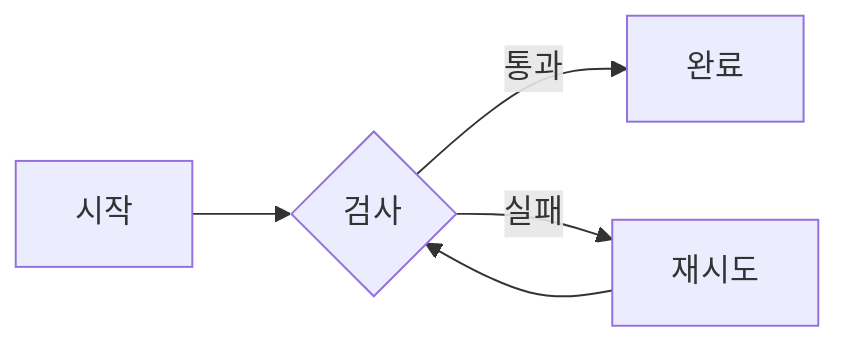
````

````markdown
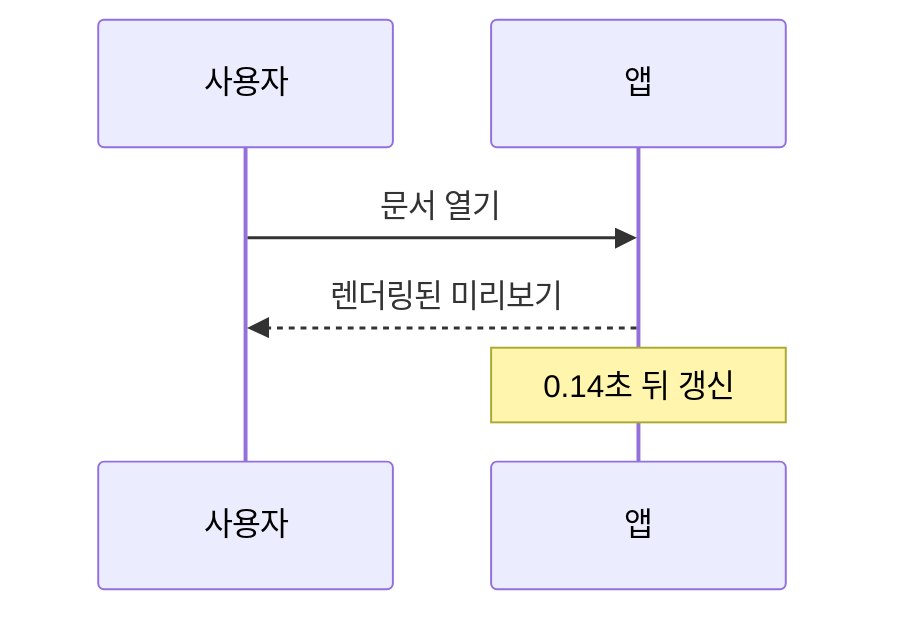
````

````markdown
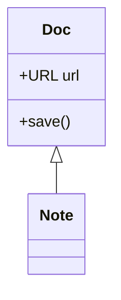
````

````markdown
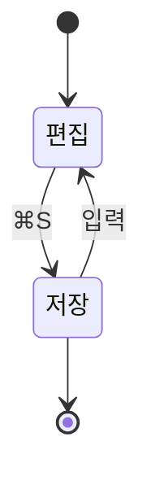
````

````markdown
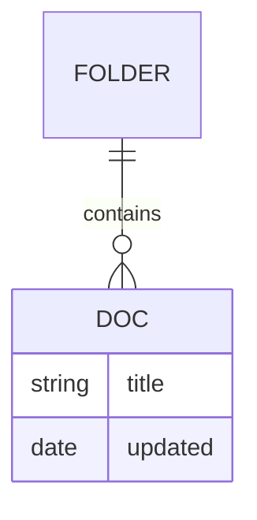
````

````markdown
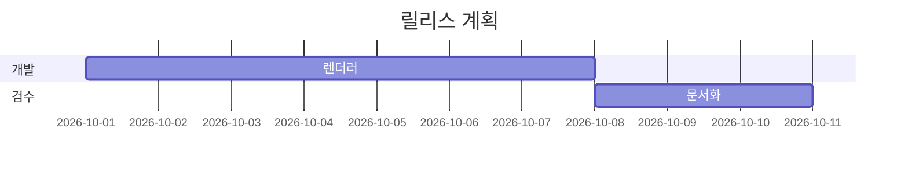
````

````markdown
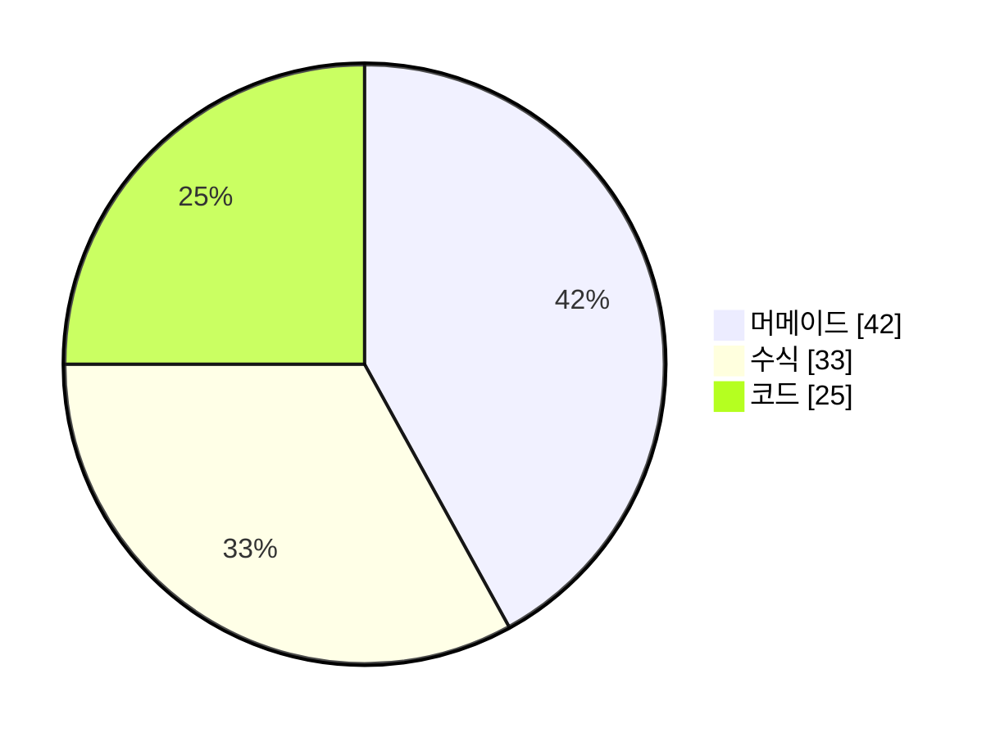
````

````markdown
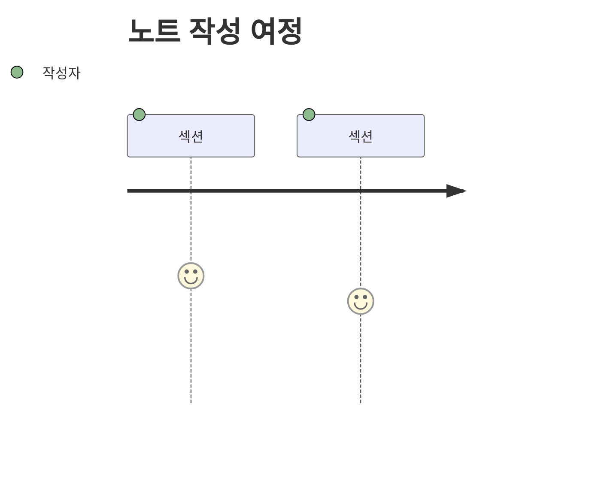
````

````markdown
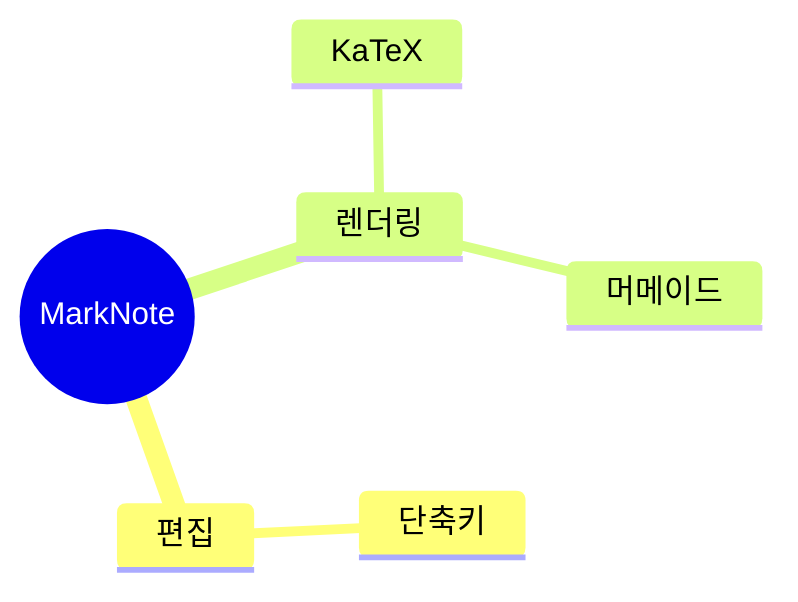
````

````markdown
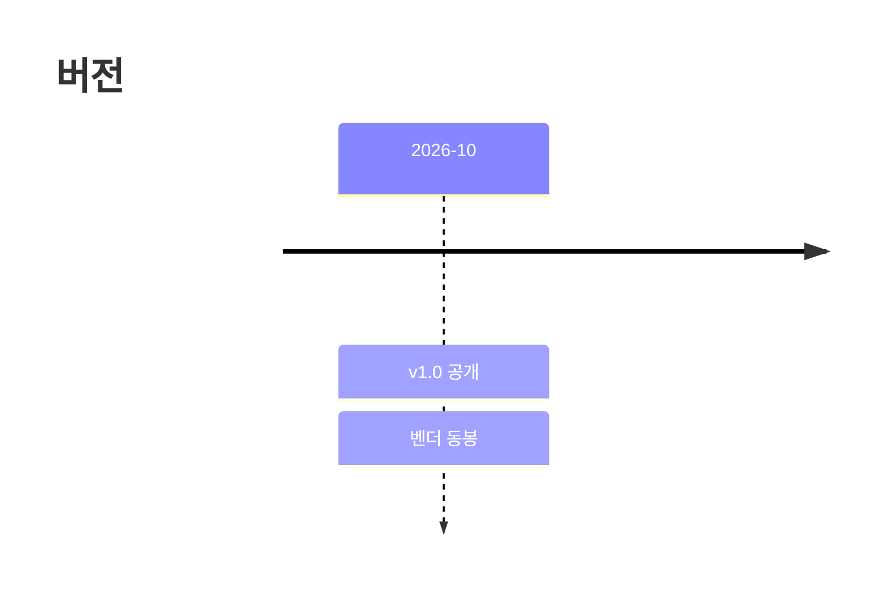
````

````markdown
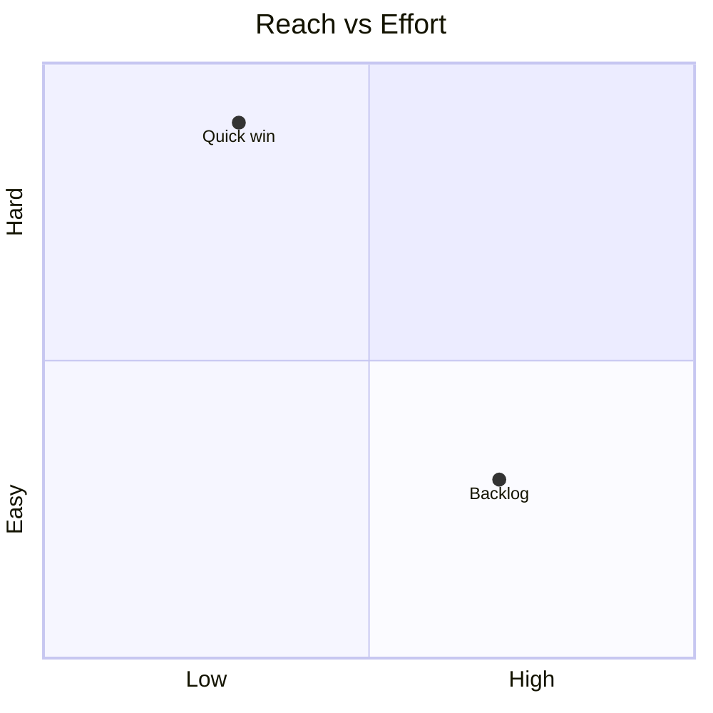
````

````markdown
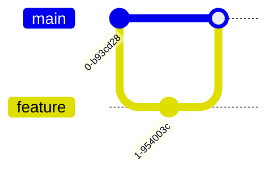
````

````markdown
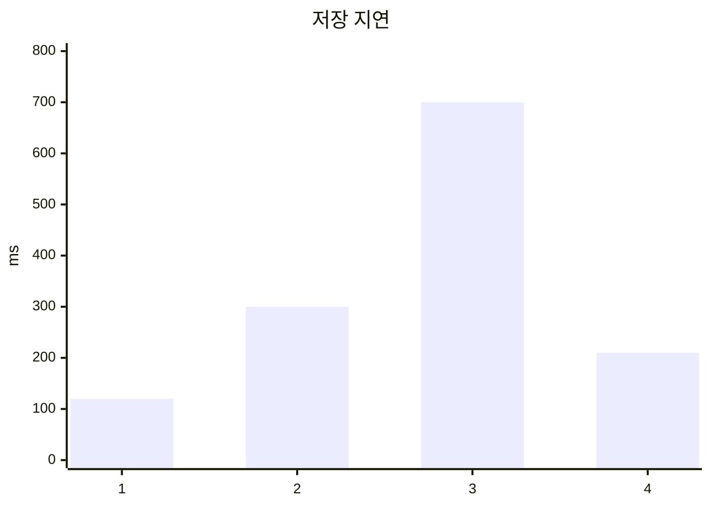
````

````markdown
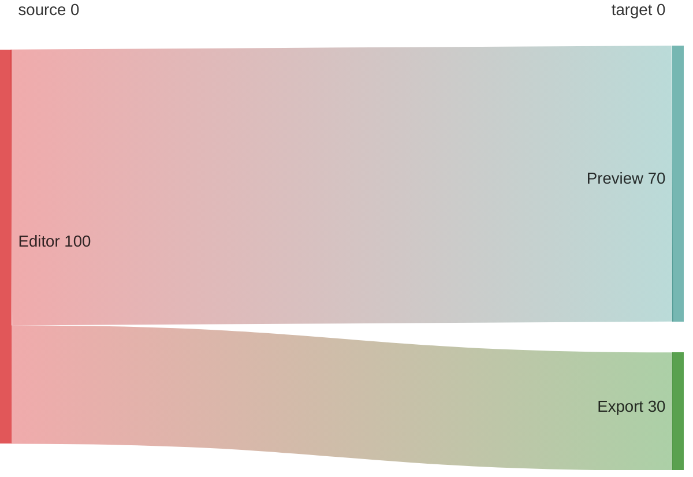
````

````markdown

````

`packet-beta`, `architecture-beta`, `ishikawa-beta`, `kanban`, `requirementDiagram`은 동봉된 10.9.3 UMD 빌드에 포함되어 있지 않습니다. 이 경우 다이어그램은 그림 대신 원문 텍스트 카드로 남으니 내용은 잃지 않습니다.

### 이미지와 노트 링크

````markdown

[다른 노트](other.md)
````

미리보기는 열어 둔 문서의 폴더를 기준으로 삼습니다. 다른 노트 링크를 클릭하면 편집기가 그 파일을 엽니다.

### 위키 링크와 백링크

````markdown
오늘 이야기는 [[회의록]] 에 정리했다.
별칭도 된다: [[회의록|2주 회의록]].
다른 노트의 제목으로: [[회의록#결정 사항]]
같은 노트 안에서: [#결정 사항]
없는 노트도 가리킬 수 있다: [[아직-없는-노트]]  ← 점선으로 표시되고, 저장하면 연결된다
````

`서식 ▸ 위키 링크 [[노트]]`(`⌥⌘K`)가 커서를 감싸고, 없는 선택이면 자리에 `[[노트 이름]]`을 넣어 줍니다.

`[[회의록]]`을 적은 쪽이 **나가는 링크**, 회의록.md를 열었을 때 사이드바 아래에 뜨는 목록이 **백링크**입니다. 아래 예제처럼 두 노트를 같은 폴더에 만들면 양쪽이 실제로 채워집니다.

````markdown
<!-- 노트: 프로젝트-원칙.md -->
# 프로젝트 원칙

- 한 번에 한 파일만 고친다 → [[안전-규칙]]
- 저장하기 전에는 항상 테스트 실행
````

````markdown
<!-- 노트: 안전-규칙.md -->
# 안전 규칙

이 규칙을 [[프로젝트-원칙]] 에서 인용한다.
````

`안전-규칙.md`를 열면 사이드바 아래에 `이 문서를 참조 (1)`이 뜨고, 행을 누르면 `프로젝트-원칙.md`의 그 줄로 갑니다. 반대로 `프로젝트-원칙.md` 안에서 위키 링크는 클릭 가능한 실선 링크, 아직 존재하지 않는 `[[아직-없는-노트]]`는 회색 점선으로 보입니다.

### 태그

````markdown
# 주간 메모

이번 주 초점은 #기획 이고, #기획/2026-10 는 다음 주로 미룬다.
마감 논의는 #회의 에서 했다.

```bash
# 이 줄은 쉘 주석이라 태그가 아니다
curl "https://example.com/#조각"   # URL 조각도 태그가 아니다
```

`#태그`라고 인라인 코드에 적으면 예제로 봅니다 — 태그가 아닙니다.
````

이 노트를 저장하면 사이드바 위 칩 칸에 `#기획`, `#회의`, `#기획/2026-10`이 줄 서고(많이 쓰인 태그가 앞에 섭니다), 다른 노트까지 합쳐 두 노트가 `#기획`을 쓰면 그 칩은 `#기획 2`로 개수를 붙여 보여 줍니다. `#기획`을 누르면 목록이 그 태그를 단 노트만 남깁니다. 같은 칩을 다시 누르거나 `필터 해제`를 누르면 전체로 돌아갑니다. 미리보기에서 본문 태그 칩을 눌러도 같은 필터가 걸립니다.

### 제목 언급을 위키링크로

`서식 ▸ 제목 언급을 위키링크로`(`⌥⌘M`)는 본문에 그냥 적힌 다른 노트 제목을 `[[위키링크]]`로 바꿔, 백링크를 클릭 가능한 연결로 굳힙니다. 같은 폴더에 `안전-규칙.md`, `프로젝트-원칙.md`, `회의록.md`가 있다고 하고 이 노트를 열어 보세요.

````markdown
# 오늘의 메모

읽을 것: 안전-규칙, 프로젝트-원칙.
회의록을 길게 잡지는 말자.        ← 조사가 붙으면 다른 말이므로 넘깁니다
[[프로젝트-원칙]]은 이미 링크라 그대로이고, `안전-규칙`이라고 코드처럼
적힌 곳과 https://example.com/프로젝트-원칙 같은 URL 속도 건드리지 않습니다.
````

`⌥⌘M`을 누르면 맨 제목으로 적힌 두 곳만 링크가 됩니다 — `안전-규칙`, `프로젝트-원칙`. 조사가 붙은 `회의록을`은 그대로 남습니다.

````markdown
# 오늘의 메모

읽을 것: [[안전-규칙]], [[프로젝트-원칙]].
회의록을 길게 잡지는 말자.
[[프로젝트-원칙]]은 이미 링크라 그대로이고, `안전-규칙`이라고 코드처럼
적힌 곳과 https://example.com/프로젝트-원칙 같은 URL 속도 건드리지 않습니다.
````

- 대상은 사이드바에 보이는 노트 제목이고, 열어 둔 노트 자기 자신은 빠집니다.
- 앞뒤가 문자·숫자인 언급은 넘깁니다. 한국어는 조사가 붙으면 그 말이 더 이상 제목이 아니기 때문입니다.
- 제목과 똑같이 적힌 곳만 봅니다. `안전 규칙`(띄어쓰기)은 `안전-규칙`과 다른 문자열이라 넘깁니다 — 대신 파일명의 NFD 표기와 편집기가 입력한 NFC 표기는 같은 글자로 봅니다.
- 3글자 미만 제목은 조사·부분 일치 위험이 커 후보에서 뺍니다.
- 코드 블록·인라인 코드·이미지·링크·`<태그>`·맨 URL 안은 건드리지 않고, 열 곳이 한 번에 바뀌어도 ⌘Z 한 번으로 통째로 되돌아갑니다. 메뉴에 수가 적혀 있지 않으면 승격할 곳이 없다는 뜻입니다.

### 그림 붙여넣기

클립보드에서 `⌘V`를 누르거나 Finder에서 이미지를 편집기로 끌어놓으면 그 자리에 한 줄이 생깁니다.

```markdown

```

그림 바이트는 노트 옆 `assets/`에 저장되고, TIFF·HEIC는 브라우저가 못 그려 PNG로 바뀌며, 같은 내용을 두 번 붙여넣어도 사본은 하나입니다. 이미 `assets/`에 있는 파일을 붙여넣으면 복사하지 않고 그 경로를 링크합니다. 24 MB를 넘는 파일은 저장하지 않고 이유를 상태 바에 적습니다.

### 인쇄와 PDF

`⌘P`는 인쇄 패널을, `⇧⌘P`는 PDF 파일을 저장합니다. 위에서 적은 태그·위키 링크 예제를 그대로 뽑으면 여백 46.5pt A4 세로 쪽으로 나가고, 다크 모드에서도 종이는 흰 바탕에 검은 글자입니다. 쪽은 문단과 표·코드 블록 경계에서 끊기므로 표의 맨 윗줄이 잘린 채 다음 쪽으로 가지 않습니다.

## 저장소 구성

```
Sources/
  App.swift            앱 생명주기, 메인 메뉴(단축키 정의)
  MainController.swift 창·툴바·분할 레이아웃, 하단 상태 바, 액션
  Store.swift          문서/폴더 상태, 정렬, 자동 저장, 디스크 감시, 참조·태그 조회, 내보내기, 인쇄 연결, 히스토리 연결
  History.swift        이전 버전 보관·조회·복원(.marknote-history, 해시 무결성 검사)
  HistoryPanel.swift   저장 히스토리 창(버전 목록, 확인 후 되돌리기)
  EditorPane.swift     NSTextView 편집기, 구문 하이라이트 적용, 그림 붙여넣기·드롭 받기
  Attachments.swift    클립보드·드롭 그림을 assets/에 저장하고 링크로 바꾸기(중복 바이트 제거, TIFF·HEIC 변환)
  Sidebar.swift        문서 목록(소스 리스트 테이블), 정렬 바, 검색, 태그 칩 칸, 참조 패널, 드래그＆드롭
  Backlinks.swift      위키 링크/링크/제목 언급 스캐너, 전·후방 참조 인덱스
  Tags.swift           `#태그` 규칙과 인덱스, 코드 펜스·인라인 코드를 본문에서 가르는 시선(NoteProse)
  Promotion.swift      맨 제목 언급을 `[[위키링크]]`로 바꾸는 계획·적용(NFC/NFD, 조사 붙은 말 넘기기)
  PreviewPane.swift    WKWebView 미리보기, 점진적 갱신, 스크롤 브리지, 태그 칩
  Markdown.swift       마크다운 → HTML 변환, 스타일시트, 내보내기 페이지, 인쇄 레이아웃 수치(PrintLayout)
  Printing.swift       인쇄·PDF 다리 — 블록 경계로 쪽 나누기, 잘라 뽑은 조각을 A4에 조판, 인쇄 패널 준비
  Vendor.swift         동봉 렌더러 경로, marknote:// 스킴 핸들러, 인라인 내보내기
  Editing.swift        서식 명령, Enter/Tab 동작 등 편집 로직
  Theme.swift          동적 컬러, 폰트, 원문 구문 하이라이트 규칙
  Utils.swift, Welcome.swift
Resources/vendor/      mermaid · highlight.js · KaTeX 사본 + 웹폰트 + 라이선스 (3.9 MB)
docs/screenshot.png    README 미리보기 이미지
docs/예제-모음.md      복사해서 쓰는 예제 원문(그대로 열 수도 있는 노트)
Info.plist             문서 타입 등록(.md, .markdown, .mdown)
build.sh               컴파일 → 벤더 복사 → 서명 → 설치
```

## 알려진 제한

- `.app`은 애드혹 서명이라 App Store 외 배포용 검증(공증)이 없습니다. 로컬 빌드는 문제없지만, 다른 기기로 옮기면 Gatekeeper 경고를 무시해야 합니다.
- 표·중첩 목록은 일반적인 사용 예에 맞춰 렌더링하는 간소 파서입니다. CommonMark 전부를 검증하지는 않습니다.
- RTF로 저장된 노트를 열 때는 텍스트만 복원합니다 — 글자 색상·크기 같은 RTF 서식은 마크다운에 없으므로 사라집니다. 표 안의 RTF나 이미지 포함 RTF는 내용이 뭉개져 보일 수 있습니다.
- 내보낸 HTML은 사진을 파일 안에 base64로 담지만, 개당 8 MB·노트 하나당 64 MB까지입니다. 그보다 큰 그림이나 노트 폴더 *밖*을 가리키는 경로는 링크로 남으니, 그 파일까지 옮겨야 합니다. 붙여넣기로 만든 `assets/` 사진은 대체로 이 안에 들어옵니다.
- `#태그`는 CommonMark가 아니라 관습에 가까운 문법입니다. `#1` 같은 번호·`c#`·URL의 `#조각`·`## 제목`은 태그로 보지 않고, 이름은 48자에서 잘립니다. 태그 인덱스는 참조 스캐너의 한 번의 훑기를 함께 쓰므로 디스크의 내용을 봅니다 — 새 태그는 저장을 한 번 해야 칩에 뜨고, 참조와 같은 제한(UTF-8 텍스트, 1 MB를 넘는 노트)을 같이 받습니다.
- 필터로 걸어 둔 태그가 사라지면(노트를 지우거나 태그 이름을 바꾸면) 필터는 스스로 풀립니다. 목록이 빈 채로 남는 일은 없지만, 방금 지운 태그의 노트를 다시 보려면 칩을 다시 눌러야 합니다.
- 언급 승격은 노트 제목과 *똑같이* 적힌 말만 링크로 바꿉니다. `안전 규칙`(띄어쓰기)과 `안전-규칙`(하이픈)은 다른 문자열이라 넘기고, 3글자 미만 제목은 조사·부분 일치 위험이 커 후보에서 빠집니다. 결과는 편집기 텍스트만 바뀌므로 저장하지 않으면 디스크는 그대로이고, ⌘Z 한 번으로 통째로 되돌아갑니다.
- 인쇄·PDF는 A4 세로와 여백만 정합니다. 실제 용지·해상도·양면·부수는 인쇄 패널과 프린터 기본값을 따릅니다.
- PDF의 쪽 나눔은 한 번 렌더링한 종이를 블록 경계로 자릅니다. 그래서 쪽보다 긴 블록(수백 줄짜리 표·코드)을 이어 찍을 때 표의 맨 윗줄이 다음 쪽에 다시 붙지 않습니다. 평범한 노트에서는 쪽이 문단·표·코드 블록 경계에서 끊깁니다.
- 미리보기는 창 폭으로, 종이는 794px 폭으로 레이아웃하므로 행이 끝나는 자리와 다이어그램 크기가 달라 보일 수 있습니다. 저장되는 PDF는 종이 쪽 레이아웃입니다.
- PDF는 쪽마다 WebKit에 그리기를 한 번씩 시킵니다. 쪽이 많아질수록 시간이 비례해서 걸리고, 그 사이에 `⇧⌘P`를 다시 누르면 진행 중이던 작업은 "더 새로운 인쇄 요청이 들어왔습니다"로 취소됩니다.
- 인라인 수식 구분자는 `$…$`를 포함하므로 `가격은 $5와 $10` 같은 문장이 수식으로 보일 수 있습니다. 그럴 땐 `\$`로 이스케이프하거나 `보기 ▸ 그림·수식 렌더링`을 끄세요.
- 머메이드는 라이브러리가 지원하는 도형(flowchart, sequence, state, class, ER, Gantt, pie 등)까지 렌더링하며, `securityLevel: 'strict'`이라 다이어그램 안의 HTML 라벨은 실행되지 않습니다.
- 시각화 포함 HTML은 3.8 MB쯤 되는 파일입니다. 메일 첨부에는 부담스럽고, 가벼운 내보내기는 3 KB 대입니다.
- 참조(백링크) 스캐너는 UTF-8 텍스트만 읽습니다. RTF로 저장된 노트는 마크다운으로 한 번 저장한 뒤부터 인덱스에 들어갑니다. 1 MB를 넘는 노트와, 노트가 250개를 넘는 폴더의 *제목 언급* 조사는 건너뜁니다(위키·마크다운 링크는 계속 추적).
- `[[노트]]`의 href는 상대 `.md` 경로입니다. 미리보기와 노트 옆에 둔 HTML에서는 그대로 움직이지만, 내보낸 HTML만 폴더 밖으로 옮기면 노트 링크는 깨집니다(사진은 파일 안에 담기므로 남습니다).
- *제목 언급*은 가장 약한 표시입니다. "원칙"처럼 본문에 흔히 나오는 단어가 노트 이름이면 링크가 아니어도 참조로 보일 수 있습니다. 아이콘으로 위키 링크·마크다운 링크와 구분해 표시합니다.
- 코드 블록(```) 안과 인라인 코드 안의 `[[링크]]`는 예제로 간주해 세지 않습니다.
- 같은 이름의 노트가 여러 개면(서브폴더 포함) 목록에서 먼저 발견된 쪽으로 갑니다. 링크 대상은 폴더 안에서 고유한 이름으로 쓰는 것을 권장합니다.
- 저장 히스토리는 노트 옆 `.marknote-history/`에 실파일로 쌓입니다. 노트당 최근 30개까지 유지되지만 자동 저장을 켜두면 짧은 시간에도 여러 사본이 생길 수 있어, 많은 노트를 오래 쓰면 용량이 커집니다(`이 문서 히스토리 비우기…`로 정리). Git·Dropbox·iCloud 같은 동기화 폴더에서는 숨김 폴더가 하나 늘어나는 셈이라 원치면 `이전 버전 자동 보관`을 끄세요.
- 노트를 휴지통으로 옮겨도 히스토리는 휴지통에 함께 들어가지 않고 `.marknote-history`에 남습니다. 완전히 지우려면 먼저 히스토리를 비우세요.
- 되돌리기는 스냅샷 파일명과 내용 해시가 일치할 때만 실행됩니다. 사본을 손으로 고치거나 다른 내용으로 채우면 "복원 실패" 안내만 뜨고 현재 노트는 그대로입니다 — 히스토리는 실행 파일이 아니라 읽기 전용 기록으로 다룹니다.
- 파일 동기화·암호화·협업은 지원하지 않습니다. 의도된 로컬 단일 사용자 도구입니다.

## 라이선스

MarkNote 자체는 MIT — 자세한 내용은 [LICENSE](LICENSE)를 참고하세요.

동봉되는 서드파티 렌더러는 각자의 라이선스를 따릅니다.

| 라이브러리 | 버전 | 라이선스 |
| --- | --- | --- |
| Mermaid | 10.9.3 | MIT |
| highlight.js | 11.9.0 | BSD-3-Clause |
| KaTeX | 0.16.11 | MIT |

원문 사본은 `Resources/vendor/licenses/`에, 파일별 체크섬과 출처는 `Resources/vendor/manifest.json`에 포함되어 있습니다.
