# MarkNote 예제 모음

필요한 블록만 복사해서 쓰면 됩니다. 이 노트를 MarkNote로 열면 아래 내용이 그대로
렌더링되니, 미리보기로 결과를 확인한 뒤 원문만 가져가세요.
`README.md`의 **예제 — 복사해서 붙여넣기** 섹션에는 같은 예제의 원문이 정리되어 있습니다.

## 서식

**굵게**, *기울임*, ~~취소선~~, `인라인 코드`, {{형광펜}}, [링크](https://github.com/proxsolver/MarkNote), <https://example.com>

## 목록

- 글머리
  - 두 번 들여쓰면 하위 목록
    - 세 단계도 됩니다
- [ ] 할 일
- [x] 끝난 일

1. 번호 목록
2. 들여쓰면 다른 종류도 가능
   - 안쪽 글머리
   1. 안쪽 번호

## 표

| 기능 | 단축키 | 상태 |
| --- | :--: | --- |
| 미리보기 | `⌘R` | 됨 |
| 시각화 포함 내보내기 | `⌥⇧⌘E` | 됨 |

## 인용과 구분선

> 인용 블록 안에서도 **굵게**와 `코드`가 동작합니다.

---

## 코드

```swift
func greet(_ name: String) -> String {
    // 한글 주석도 그대로
    return "Hi, \(name)"
}
```

```python
def fib(n):
    a, b = 0, 1
    for _ in range(n):
        a, b = b, a + b
    return a
```

```sql
SELECT title, updated_at
FROM docs
WHERE folder = 'MarkNote'
ORDER BY updated_at DESC
LIMIT 10;
```

```bash
brew install --cask marknote   # 설치
```

```json
{ "name": "MarkNote", "offline": true }
```

## 수식

인라인: $E = mc^2$, $\frac{a}{b}$, $\sqrt{x}$, $\alpha\beta\gamma$, $\sum_{i=1}^{n} i$

$$\int_0^1 x^2\,dx = \frac{1}{3}$$

$$\lim_{n\to\infty}\left(1+\frac{1}{n}\right)^n = e$$

$$\mathbf{A} = \begin{pmatrix} a & b \\ c & d \end{pmatrix}, \quad \begin{bmatrix} 1 \\ 2 \end{bmatrix}$$

$$f(x) = \begin{cases} 1 & x \gt 0 \\ -1 & x \lt 0 \end{cases}$$

$$\overline{x} \ne \underline{x}, \quad \left\lceil \frac{n}{2} \right\rceil, \quad \boxed{42}$$

## 다이어그램

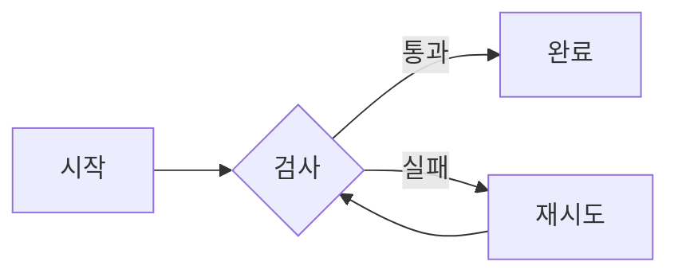

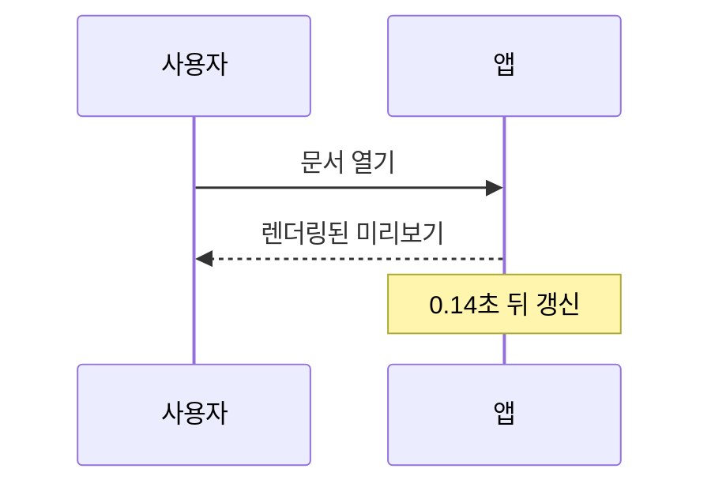

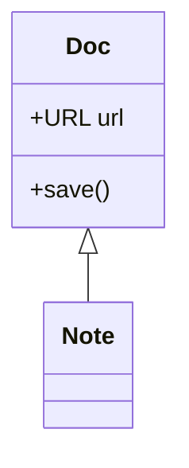

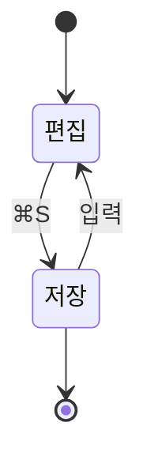

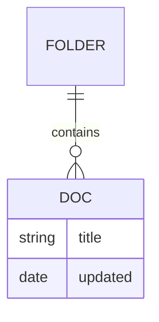


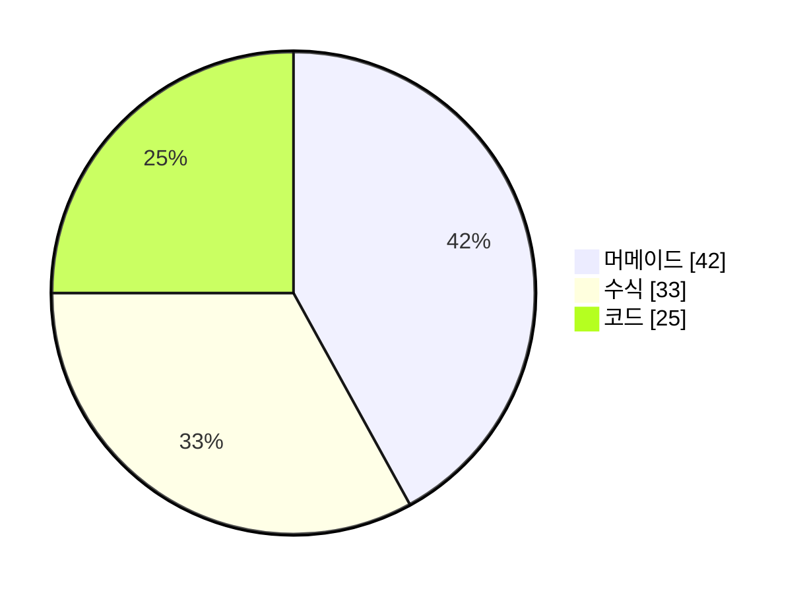

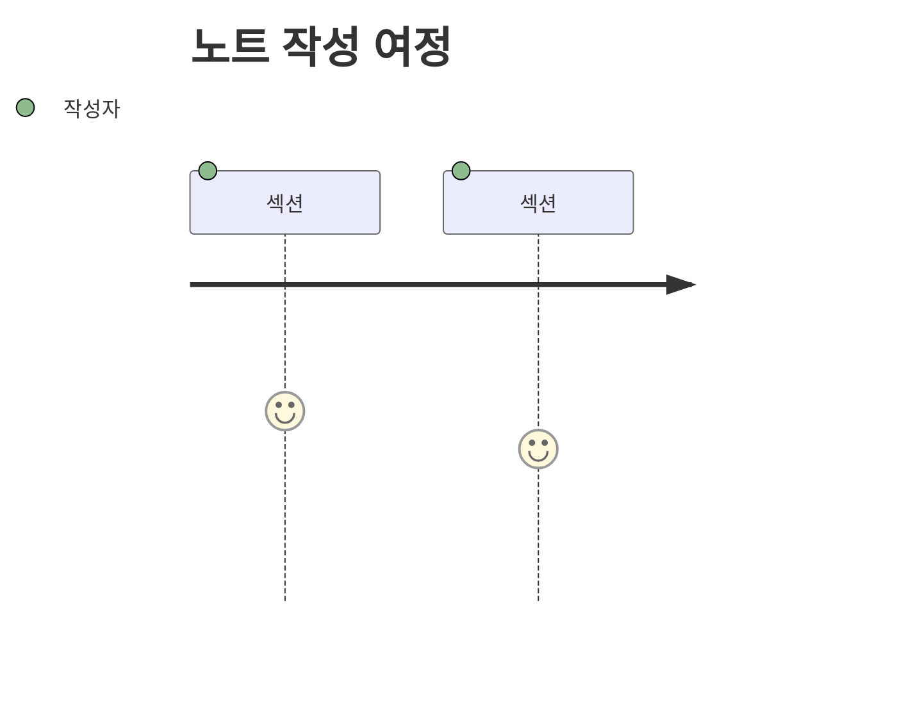

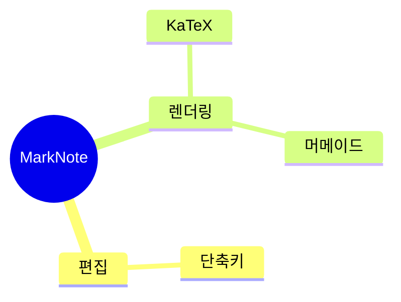

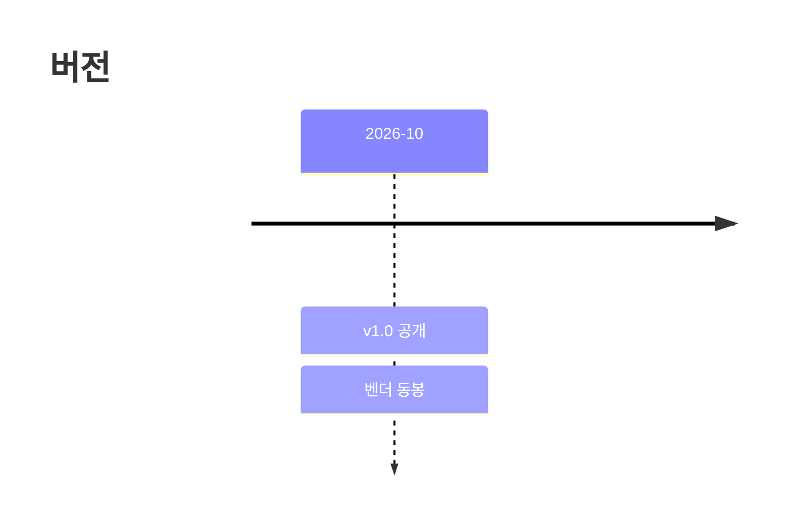

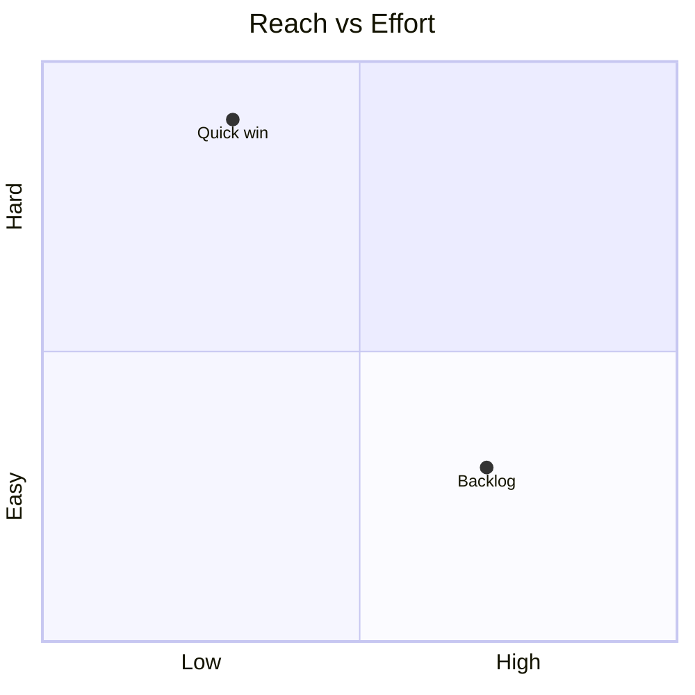

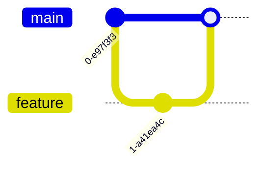

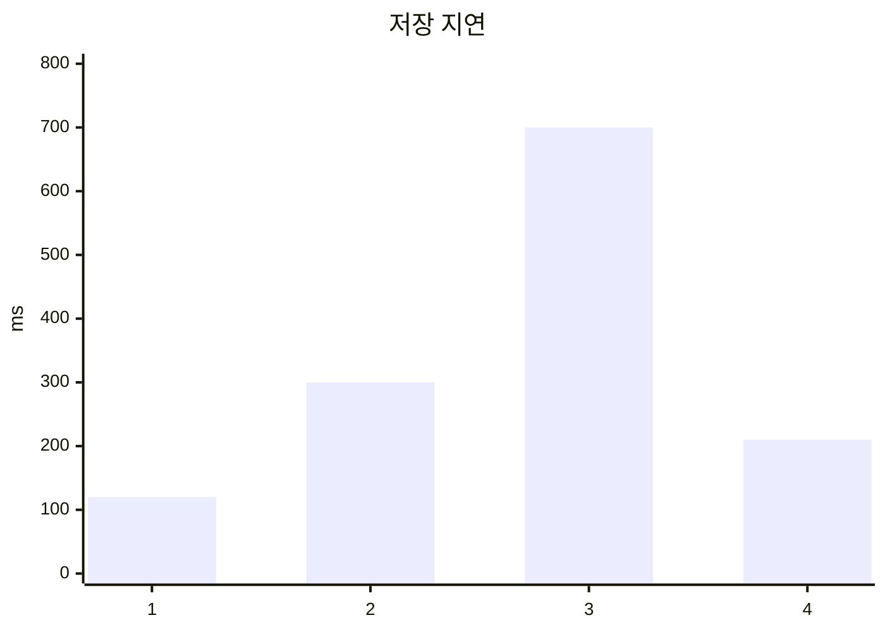

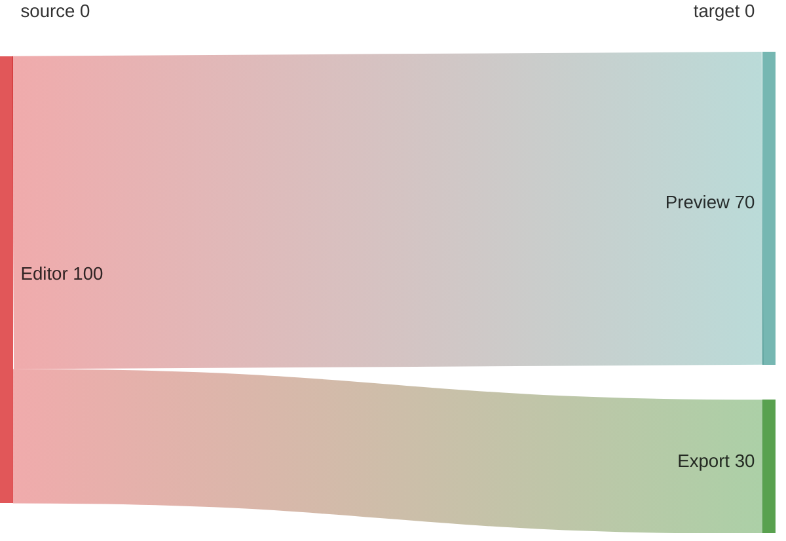


## 이미지와 상대 링크

문서 옆에 둔 이미지는 상대 경로로, 다른 노트는 `.md` 경로로 links합니다. 미리보기에서는
열어 둔 문서의 폴더를 기준으로 찾습니다.

```markdown

[다른 노트](other.md)
```

## 이 노트에서 동작하지 않는 것

`packet-beta`, `architecture-beta`, `ishikawa-beta`, `kanban`, `requirementDiagram`은
동봉된 머메이드 빌드(10.9.3 UMD)에서 사용할 수 없습니다. 그 외 문법은 원문 그대로 표시돼
글이 사라지지 않습니다.
