# MarkNote 예제 모음

필요한 블록만 복사해서 쓰면 됩니다. 이 노트를 MarkNote로 열면 아래 내용이 그대로
렌더링되니, 미리보기로 결과를 확인한 뒤 원문만 가져가세요.
`README.md`의 **예제 — 복사해서 붙여넣기** 섹션에는 같은 예제의 원문이 정리되어 있습니다.

## 서식

**굵게**, *기울임*, ~~취소선~~, `인라인 코드`, {{형광펜}}, [링크](https://github.com/proxsolver/MarkNote), <https://example.com>

## 목록

- 글머리
  - 두 번 들여쓰면 하위 목록
    - 세 단계도 됩니다
- [ ] 할 일
- [x] 끝난 일

1. 번호 목록
2. 들여쓰면 다른 종류도 가능
   - 안쪽 글머리
   1. 안쪽 번호

## 표

| 기능 | 단축키 | 상태 |
| --- | :--: | --- |
| 미리보기 | `⌘R` | 됨 |
| 시각화 포함 내보내기 | `⌥⇧⌘E` | 됨 |

## 인용과 구분선

> 인용 블록 안에서도 **굵게**와 `코드`가 동작합니다.

---

## 코드

```swift
func greet(_ name: String) -> String {
    // 한글 주석도 그대로
    return "Hi, \(name)"
}
```

```python
def fib(n):
    a, b = 0, 1
    for _ in range(n):
        a, b = b, a + b
    return a
```

```sql
SELECT title, updated_at
FROM docs
WHERE folder = 'MarkNote'
ORDER BY updated_at DESC
LIMIT 10;
```

```bash
brew install --cask marknote   # 설치
```

```json
{ "name": "MarkNote", "offline": true }
```

## 수식

인라인: $E = mc^2$, $\frac{a}{b}$, $\sqrt{x}$, $\alpha\beta\gamma$, $\sum_{i=1}^{n} i$

$$\int_0^1 x^2\,dx = \frac{1}{3}$$

$$\lim_{n\to\infty}\left(1+\frac{1}{n}\right)^n = e$$

$$\mathbf{A} = \begin{pmatrix} a & b \\ c & d \end{pmatrix}, \quad \begin{bmatrix} 1 \\ 2 \end{bmatrix}$$

$$f(x) = \begin{cases} 1 & x \gt 0 \\ -1 & x \lt 0 \end{cases}$$

$$\overline{x} \ne \underline{x}, \quad \left\lceil \frac{n}{2} \right\rceil, \quad \boxed{42}$$

## 다이어그램

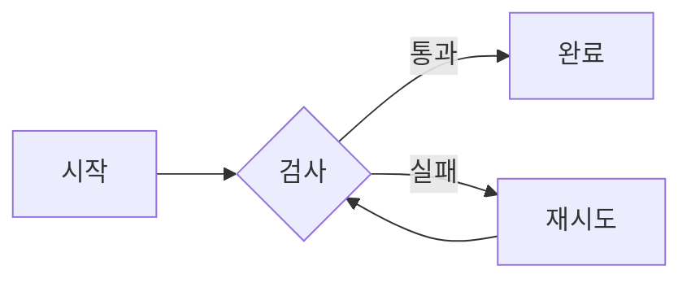

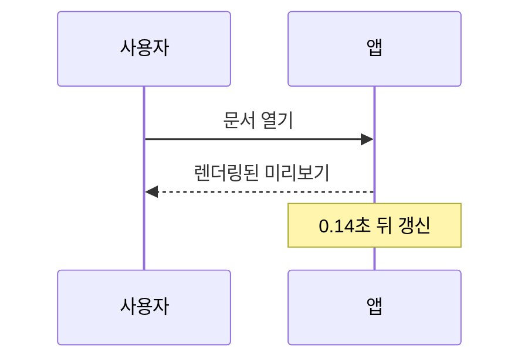

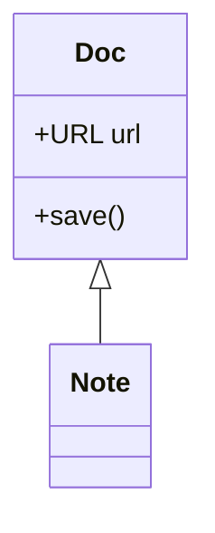

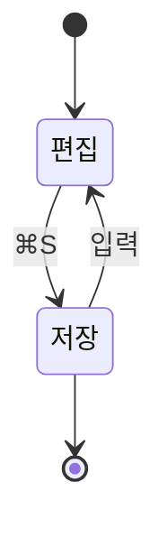

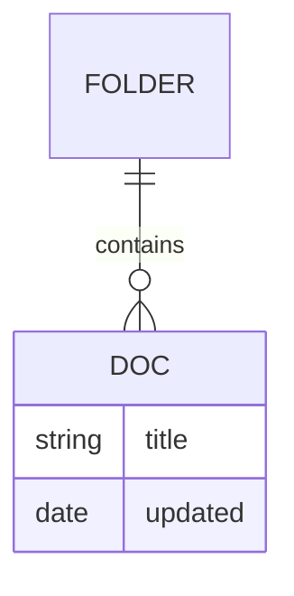

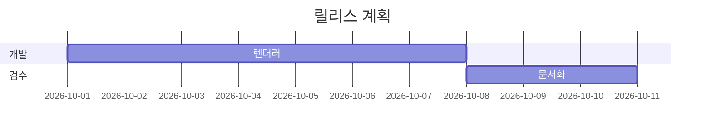

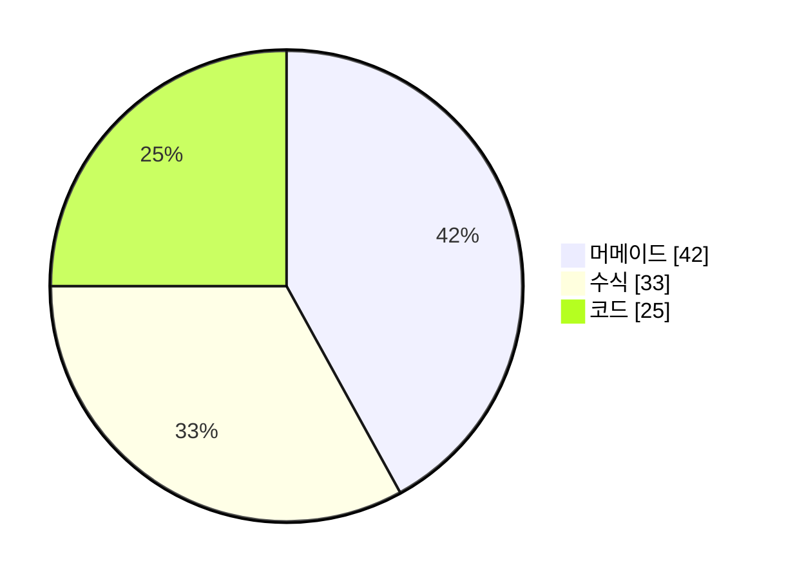

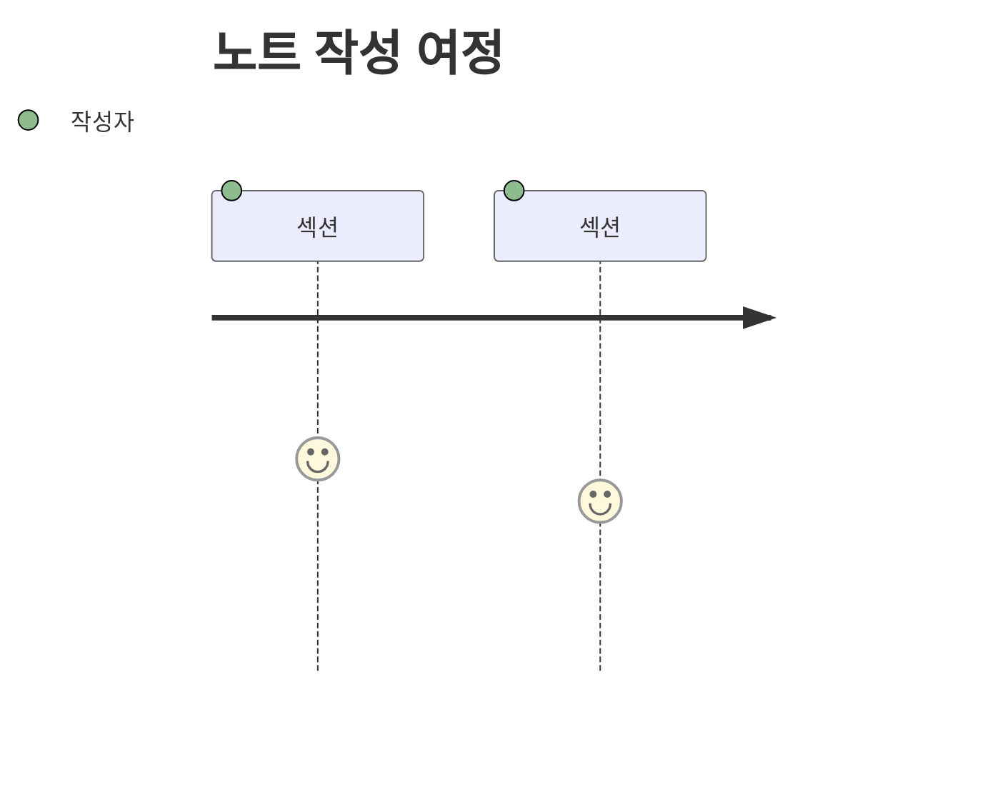

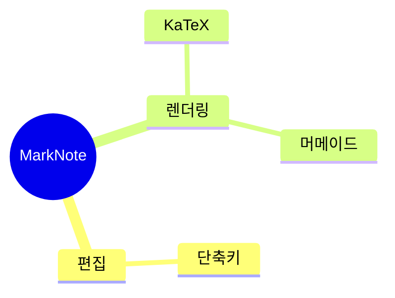

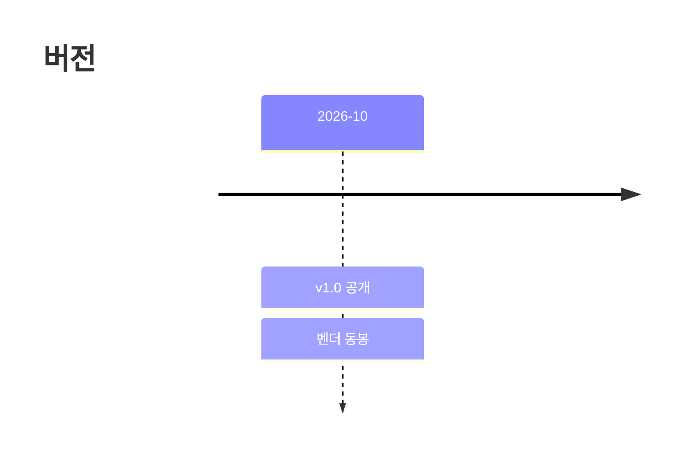

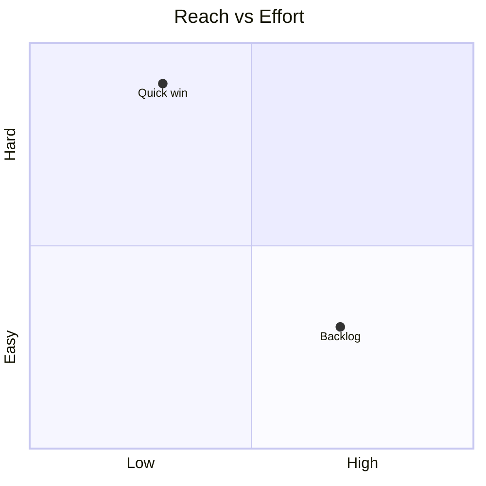

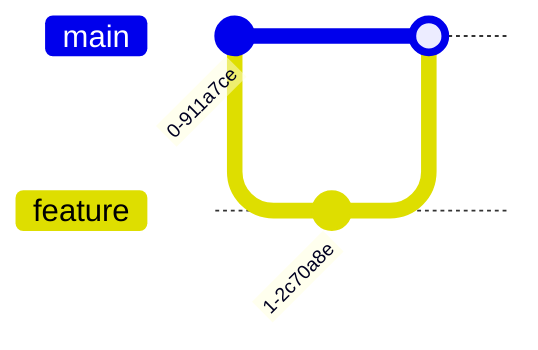

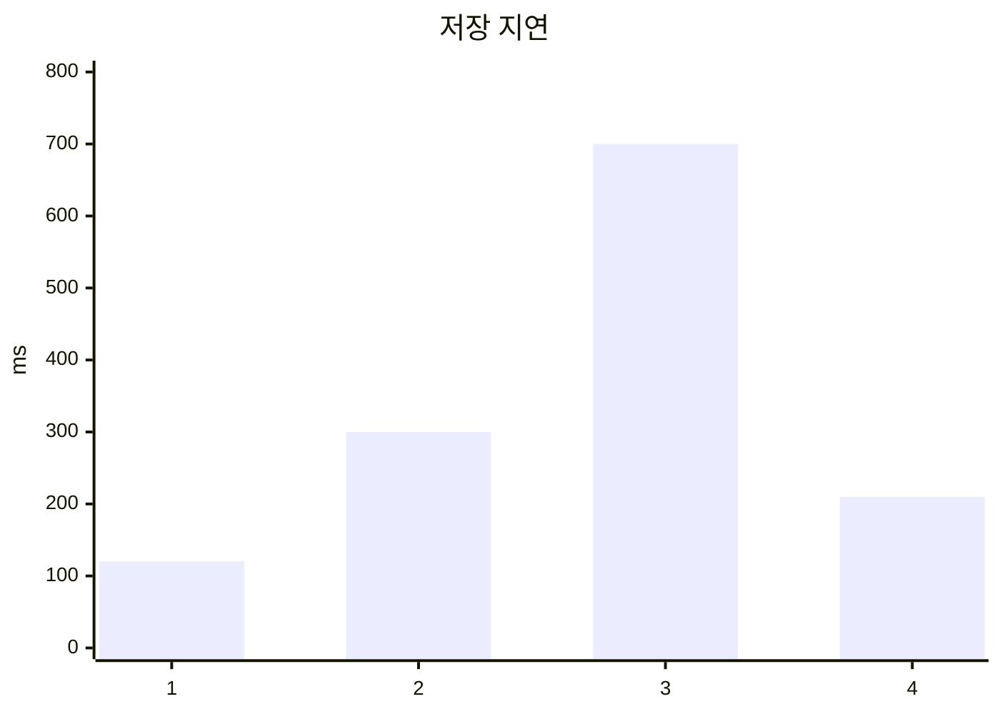

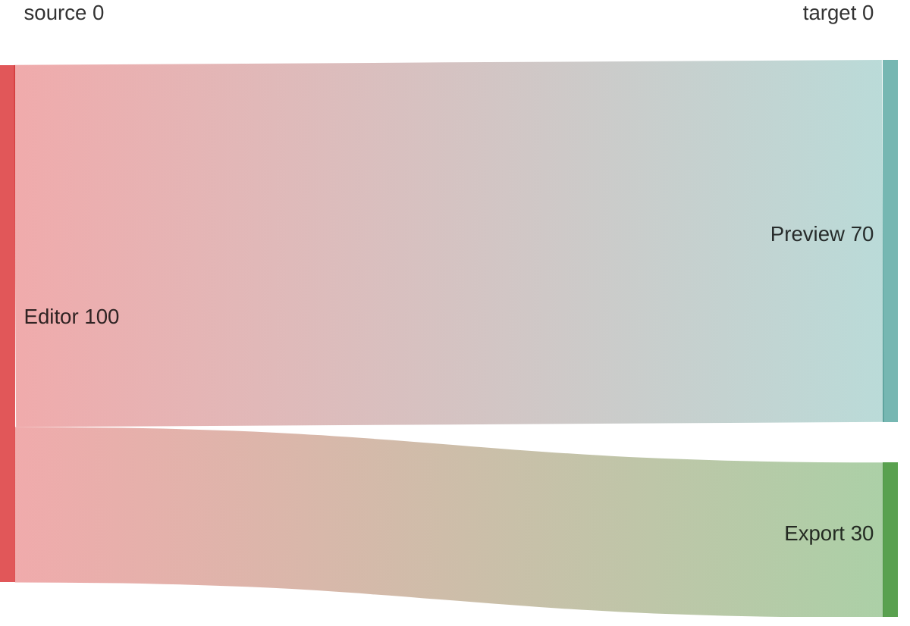


## 이미지와 상대 링크

문서 옆에 둔 이미지는 상대 경로로, 다른 노트는 `.md` 경로로 연결합니다. 미리보기에서는
열어 둔 문서의 폴더를 기준으로 찾습니다.

```markdown

[다른 노트](other.md)
```

## 위키 링크와 백링크

`[[노트 이름]]` 하나로 같은 폴더(하위 폴더 포함)의 노트를 가리킵니다. 확장자·대소문자·
빈칸은 신경 쓰지 않아도 되고, 미리보기와 내보낸 HTML에서 실제 링크가 되며 클릭하면 그
노트가 열립니다.

```markdown
- 오늘 내용은 [[회의록]] 에 정리.
- 별칭: [[회의록|2주 회의록]]
- 다른 노트의 제목으로: [[회의록#결정 사항]]
- 이 노트 안에서: [#위키 링크와 백링크]
- 없는 노트도 가능: [[아직-없는-노트]]   ← 점선으로 보이고, 그 이름으로 저장되면 연결됨
```

백링크는 반대 방향입니다. `회의록.md`를 열면 사이드바 아래 `이 문서를 참조` 패널에
*이 노트를 가리킨 노트* 목록이 뜨고, 행을 누르면 참조한 줄로 이동합니다. 아래 두 노트를
같은 폴더에 만들면 양쪽이 채워집니다.

```markdown
<!-- 프로젝트-원칙.md -->
# 프로젝트 원칙
- 한 번에 한 파일만 고친다 → [[안전-규칙]]
```

```markdown
<!-- 안전-규칙.md -->
# 안전 규칙
- 이 규칙은 [[프로젝트-원칙]] 에서 인용한다
```

이 노트에서도 두 가지 상태를 직접 확인할 수 있습니다: 같은 노트 제목으로 건너뛰는
[#이미지와 상대 링크] 은 실선 링크, 아직 없는 [[없는 노트]] 는 회색 점선입니다.

코드 블록과 인라인 코드 안의 `[[위키 링크]]`는 예제로 취급해서 세지 않습니다.

## 태그

태그는 본문 어디에나 적습니다. 이 노트에서 실제로 칩에 뜹니다: #예제 #태그/2026-10

- 사이드바 위 칩 칸에서 `#예제`를 누르면 목록이 그 태그를 단 노트만 남깁니다. 칩을 다시 누르거나 `필터 해제`로 돌아갑니다.
- 미리보기의 태그도 칩이라, 이 칩을 누르면 같은 필터가 걸립니다. 스크롤은 움직이지 않습니다.
- 닫는 코드와 인라인 코드 안의 `#`은 태그가 아닙니다.

```bash
# 이 줄은 쉘 주석이라 태그가 아닙니다
curl "https://example.com/#조각"      # URL 조각도 아니고
echo "#1 은 번호일 뿐"
```

`c#`, `폭#1`, `## 제목`처럼 `#`이 단어의 일부이거나 제목 표시인 것도 태그로 보지 않습니다.
`#React`와 `#react`는 같은 태그이고, 이름은 48자에서 잘립니다.

## 제목 언급을 위키링크로

`서식 ▸ 제목 언급을 위키링크로`(`⌥⌘M`)는 본문에 그냥 적힌 다른 노트 제목을 `[[위키링크]]`로
바꿉니다. 아래 예제를 그대로 새로 만든 노트에서 시험해 보세요(이 노트 안의 예제는 코드
블록이라 승격 대상이 아닙니다).

```markdown
<!-- 안전-규칙.md, 프로젝트-원칙.md, 회의록.md 가 있는 폴더에서 여는 노트 -->
# 오늘의 메모

읽을 것: 안전-규칙, 프로젝트-원칙.
회의록을 길게 잡지는 말자.
```

`⌥⌘M`을 누르면 `안전-규칙`과 `프로젝트-원칙` 두 곳만 `[[…]]`가 됩니다. `회의록을`은
조사가 붙어 다른 말이 되므로 그대로 남고, 이미 링크인 자리와 코드, 맨 URL도 건드리지
않습니다. 여러 곳이 한 번에 바뀌어도 `⌘Z` 한 번으로 통째로 되돌아갑니다.

## 그림 붙여넣기

클립보드의 스크린샷을 `⌘V`하거나 Finder에서 끌어온 이미지는 노트 옆 `assets/`에 저장되고
그 자리에 링크로 앉습니다.

```markdown

```

- TIFF·HEIC는 브라우저가 못 그려 PNG로 바꿔 저장합니다.
- 같은 바이트를 두 번 붙여넣어도 사본은 하나입니다.
- 이미 `assets/`에 있는 파일을 붙여넣으면 복사하지 않고 그 경로를 링크합니다.
- 24 MB를 넘는 파일은 저장하지 않고 이유를 상태 바에 적습니다.
- HTML 내보내기(두 경로 모두)는 사진을 파일 안에 base64로 담으므로, 파일을 옮겨도 이미지가 남습니다.

## 인쇄와 PDF

`⌘P`는 인쇄 패널, `⇧⌘P`는 PDF 저장입니다. 이 노트를 그대로 뽑아 보면 확인할 수 있습니다.

- 다크 모드로 보고 있어도 종이는 흰 바탕에 검은 글자입니다.
- A4 세로, 여백 좌우 46.5pt · 상하 45pt.
- 쪽은 문단·표·코드 블록 경계에서 끊기고, 제목이 쪽 끝에 혼자 남지 않습니다.
- 이 노트의 머메이드 다이어그램과 KaTeX 수식도 종이에 올라갑니다(`보기 ▸ 그림·수식 렌더링`이 켜져 있을 때).

## 이 노트에서 동작하지 않는 것

`packet-beta`, `architecture-beta`, `ishikawa-beta`, `kanban`, `requirementDiagram`은
동봉된 머메이드 빌드(10.9.3 UMD)에서 사용할 수 없습니다. 그 외 문법은 원문 그대로 표시돼
글이 사라지지 않습니다.
